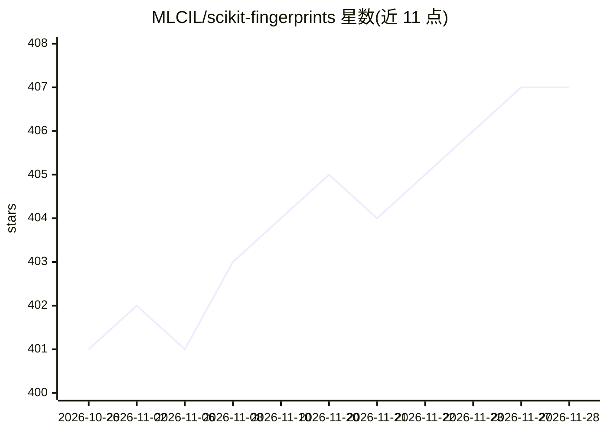

# MLCIL/scikit-fingerprints

⭐ 407 · Python · MIT · 推送 2026-11-16 · [GitHub](https://github.com/MLCIL/scikit-fingerprints) · [官网](https://scikit-fingerprints.readthedocs.io/latest/) · 组织维护

**面向化学信息学开发者的 scikit-learn 兼容分子指纹计算库**

scikit-learn 兼容的 Python 库，用于计算分子指纹、分子过滤器、距离与相似度度量。提供 30 余种指纹（ECFP、MACCS、Mordred 等）与统一的 .transform() 接口，输入 SMILES 输出 NumPy 数组，可嵌入 sklearn Pipeline、GridSearchCV 等工具链。内置基准数据集与训练测试划分、适用域检查方法，底层使用 C++ RDKit 并支持并行与稀疏矩阵。支持 Python 3.11-3.13，覆盖 Linux/Windows/macOS，MIT 许可。

## 筛选速览

| 维度 | 判定 | 备注 |
|---|---|---|
| AI 角色 | `ai-native` | 本体是模型或模型工具 |
| 许可风险 | `permissive` | MIT |
| 部署形态 | `library` | 以包/库形式分发 |
| 模型依赖 | — | README 未给出锁定关系 |
| 硬件要求 | — | 无带数字的原话,不猜 |
| 安装摩擦 | `low` | 无编译、无系统依赖或容器化 |
| 成熟度 | — | 结构信号不足 |

## 能力要点

- 30 余种分子指纹统一 .transform() API，SMILES 输入、NumPy 输出
- 30 余种分子过滤器与 14 种相似度/距离度量
- 与 scikit-learn Pipeline、FeatureUnion、GridSearchCV 原生集成
- 内置 MoleculeNet、TDC 等基准数据集与训练测试划分

## 适用场景

- 从 SMILES 构建分子性质的机器学习流水线
- 对候选分子批量计算相似度与聚类
- 用 Lipinski、PAINS 等过滤器筛选化合物库
- 在基准数据集上评估分子模型可靠性

## 场景标签

 · 领域:化学信息学/机器学习

## 证据(README 行号)

> L10:  The scikit-learn compatible library for molecular fingerprints and chemoinformatics.
> L12:  Easily and efficiently compute molecular fingerprints, molecular filters, distances &amp; similarity measures, and
> L93: - **Native scikit-learn integration**

## 星数曲线

2026-10-26 401 → 2026-11-28 407（+6）

---
*卡片 v1 · prompt 1.4 · 生成 2026-11-25 · 置信度 high · 依据 README sha `027a3c0115ef` · [字段定义](../../DATASET.md)*
