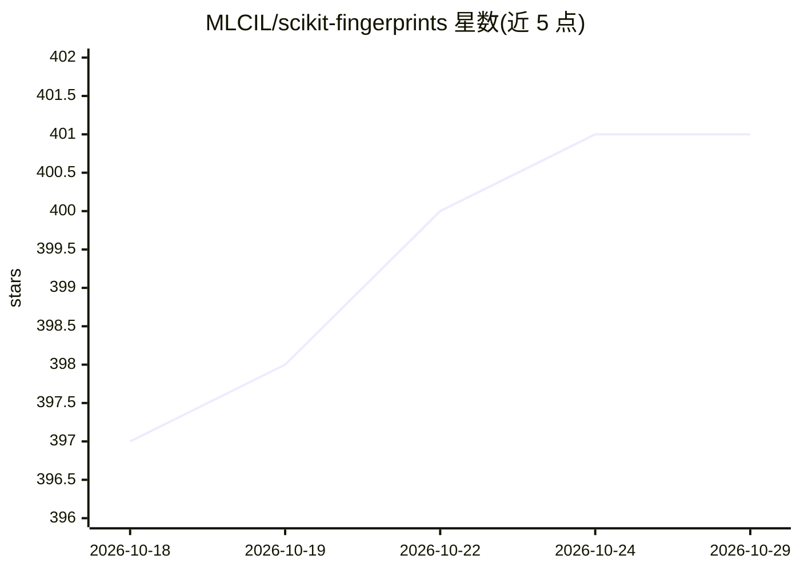

# MLCIL/scikit-fingerprints

⭐ 401 · Python · MIT · 推送 2026-10-26 · [GitHub](https://github.com/MLCIL/scikit-fingerprints) · [官网](https://scikit-fingerprints.readthedocs.io/latest/) · 组织维护

**化学信息学库：为分子提供 30+ 种分子指纹与 ML 管道**

兼容 scikit-learn 的化学信息学 Python 库：输入 SMILES 字符串即可通过统一的 .transform() API 计算 30 余种分子指纹（ECFP、Avalon、MACCS、Mordred、PubChem 等），并提供 30 余种分子过滤器（Lipinski、PAINS、REOS）、14 种相似性/距离度量、11 种适用域检查方法及 MoleculeNet、TDC 等基准数据集。底层依赖 C++ 实现的 RDKit，支持并行与稀疏矩阵。面向构建分子机器学习流水线的科研与工业开发者，MIT 许可，兼容 Python 3.11–3.13。

## 筛选速览

| 维度 | 判定 | 备注 |
|---|---|---|
| AI 角色 | `ai-native` | 本体是模型或模型工具 |
| 许可风险 | `permissive` | MIT |
| 部署形态 | `library` | 以包/库形式分发 |
| 模型依赖 | — | README 未给出锁定关系 |
| 硬件要求 | — | 无带数字的原话,不猜 |
| 安装摩擦 | `low` | 无编译、无系统依赖或容器化 |
| 成熟度 | — | 结构信号不足 |

## 能力要点

- 30 余种分子指纹，统一 .transform() API，SMILES 输入直接产出 NumPy 数组
- 30 余种分子过滤器与 14 种相似性/距离度量
- 内置 MoleculeNet、TDC、MoleculeACE、LRGB 基准数据集及训练/测试划分
- 原生兼容 scikit-learn Pipeline / FeatureUnion / GridSearchCV，支持指纹缓存加速调参

## 适用场景

- 从 SMILES 快速构建分子性质预测的机器学习流水线
- 用分子过滤器（Lipinski、PAINS 等）筛选化合物库
- 做分子聚类、相似性检索或适用域可靠性评估
- 在基准数据集上复现或对比分子机器学习方法

## 场景标签

`科研工具` · 领域:学习与行业

## 证据(README 行号)

> L10:  The scikit-learn compatible library for molecular fingerprints and chemoinformatics.
> L58: X = fp.transform(smiles)  # SMILES in, NumPy array out
> L73:  - over 30, e.g. ECFP, Avalon, MACCS, Mordred, PubChem

## 星数曲线

2026-10-18 397 → 2026-10-29 401（+4）

---
*卡片 v1 · prompt 1.4 · 生成 2026-10-21 · 置信度 high · 依据 README sha `963d7237ee6f` · [字段定义](../../DATASET.md)*
