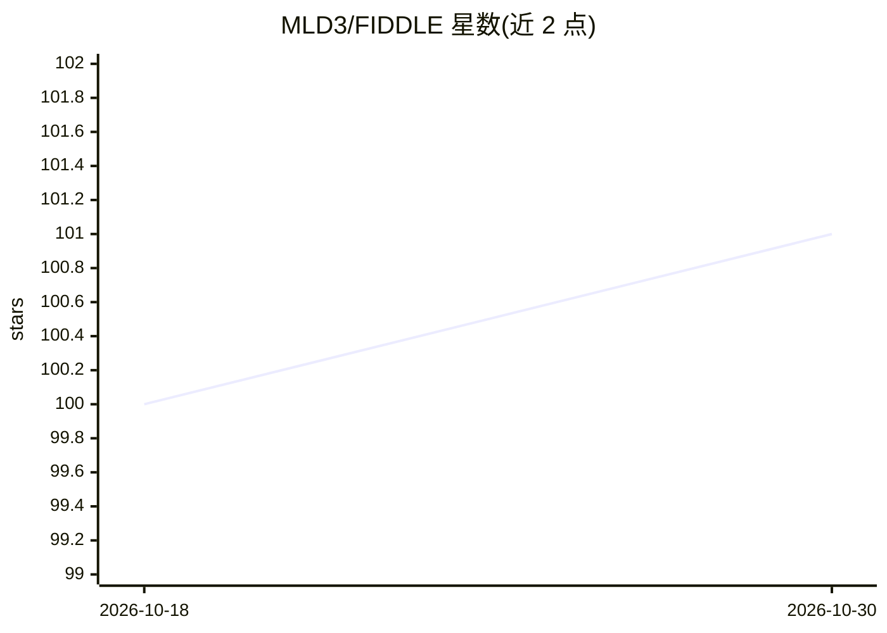

# MLD3/FIDDLE

⭐ 101 · Jupyter Notebook · MIT · 推送 2026-03-19 · [GitHub](https://github.com/MLD3/FIDDLE) · [官网](http://tiny.cc/get_FIDDLE) · 组织维护

**把结构化 EHR 数据转成 ML 特征向量的预处理流水线**

FIDDLE 读取四列格式（ID/t/variable_name/variable_value）的结构化电子病历数据与人群清单，依据少量用户参数（预测时间 T、时间粒度 dt、过滤阈值 θ、统计函数等）生成时不变特征向量 s 与时间序列特征张量 X，供下游机器学习模型使用，可用于不良结局预测等任务。以 Python 3.7+ 形式提供，通过 requirements.txt 安装，亦可构建 Docker 镜像运行；已随论文发布 MIMIC-III 与 eICU 的预处理特征。参数设置需结合预测频率、数据时间密度与类别平衡调整。

## 筛选速览

| 维度 | 判定 | 备注 |
|---|---|---|
| AI 角色 | `ai-ecosystem` | LLM/agent 周边工具 |
| 许可风险 | `permissive` | MIT |
| 部署形态 | `self-host` | docker 或自建部署 |
| 模型依赖 | — | README 未给出锁定关系 |
| 硬件要求 | — | 无带数字的原话,不猜 |
| 安装摩擦 | `low` | 无编译、无系统依赖或容器化 |
| 成熟度 | — | 结构信号不足 |

## 能力要点

- 少量用户参数（T、dt、θ 阈值、统计函数）即可完成特征生成
- 输出稀疏时不变特征 (N,d) 与时间序列特征张量 (N,L,D) 及特征名/别名元数据
- 提供 Pre-filter/Post-filter 与频繁变量汇总统计机制
- 已发布 MIMIC-III 与 eICU 预处理特征及实验复现代码

## 适用场景

- ICU 风险分层研究中把 EHR 时序数据编码为模型输入
- 复现 JAMIA 论文中 MIMIC-III/eICU 实验
- 临床预测模型开发前的特征工程

## 场景标签

 · 领域:医疗健康/机器学习数据预处理

## 证据(README 行号)

> L3: FIDDLE – F lex I ble D ata- D riven pipe L in E – is a preprocessing pipeline that transforms structured EHR data in
> L36: FIDDLE generates feature vectors based on data within the observation period $t\in[0,T]$. This feature representati
> L89: In this repository, we release FIDDLE as a standalone software. In order to show the flexibility and utility of FID

## 星数曲线

2026-10-18 100 → 2026-10-30 101（+1）

---
*卡片 v1 · prompt 1.4 · 生成 2026-10-23 · 置信度 high · 依据 README sha `5573209e3cfd` · [字段定义](../../DATASET.md)*
