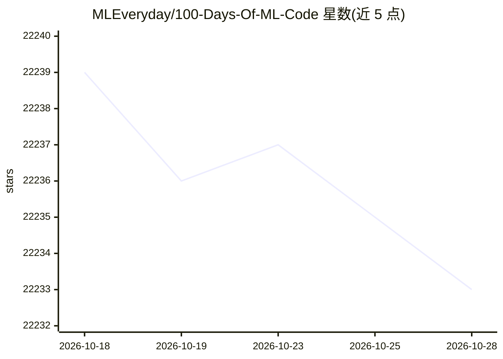

# MLEveryday/100-Days-Of-ML-Code

⭐ 22,234 · Python · MIT · 推送 2026-10-24 · [GitHub](https://github.com/MLEveryday/100-Days-Of-ML-Code) · 个人维护 · 中文 README

**机器学习中文学习路线：Day1~54 讲解、代码与练习**

基于 Avik-Jain 英文项目的中文版机器学习学习路线，覆盖 Day 1～54（Day 55～100 未编写）。内容含数据预处理、监督/无监督学习、神经网络基础、CNN 与聚类等，提供逐日课程目录、Python 3.11/3.12 环境安装说明、数据集准备与常见问题解答；以分步代码与 Markdown 注释为源，用脚本同步生成 .md 与 .ipynb 课程文件。基础课程不需要 GPU。

## 筛选速览

| 维度 | 判定 | 备注 |
|---|---|---|
| AI 角色 | `ai-knowledge` | 知识聚合/清单类 |
| 许可风险 | `permissive` | MIT |
| 部署形态 | `library` | 以包/库形式分发 |
| 模型依赖 | — | README 未给出锁定关系 |
| 硬件要求 | `cpu-ok` | |
| 安装摩擦 | `low` | 无编译、无系统依赖或容器化 |
| 成熟度 | — | 结构信号不足 |

## 动量与使用信号

- 维护:`active` — 距上次 push 9.8 天,年发版 0,21 位贡献者
- 涨星:近 1 天 **-1**(自 20261016 起算)

## 能力要点

- 逐日课程目录：目标、代码与练习（Day 1～54）
- 运行 tools/sync_lessons.py 生成配套 .md 与 .ipynb
- 更新至现代 scikit-learn 与 Keras 3 用法
- 基础课程不需要 GPU

## 适用场景

- 零基础或有基础者按 100 天路线系统学习机器学习
- 需要中文讲解配合可运行代码练习
- 复现数据预处理、分类、聚类等教学实验

## 场景标签

`教程课程` · 领域:学习与行业

## 证据(README 行号)

> L5: 本项目基于 Avik-Jain 的英文项目，提供中文机器学习学习路线、讲解与练习。
> L12: - 环境安装与运行：Python 3.11/3.12、基础和深度学习依赖、Notebook 内核。
> L24: 脚本默认把图形保存在 `outputs/`。打开 Notebook 时按顺序运行所有单元；完整说明见安装文档。深度学习依赖单独安装，基础课程不需要 GPU。

## 星数曲线

2026-10-18 22,239 → 2026-10-28 22,233（-6）

---
*卡片 v1 · prompt 1.4 · 生成 2026-10-18 · 置信度 high · 依据 README sha `49c68a468704` · [字段定义](../../DATASET.md)*
