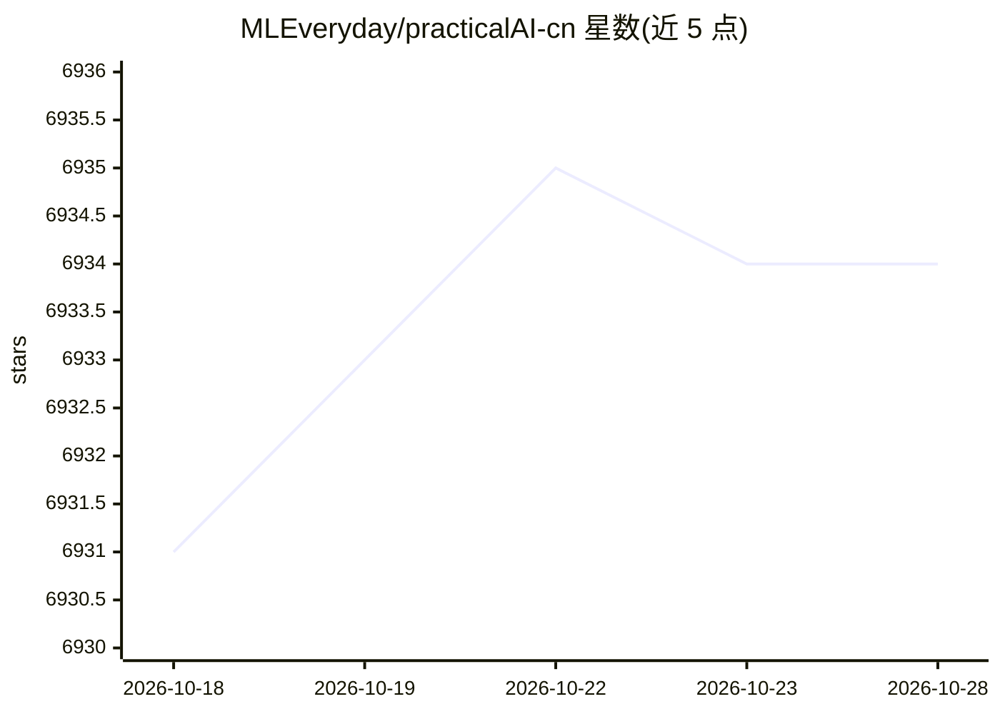

# MLEveryday/practicalAI-cn

⭐ 6,935 · Jupyter Notebook · MIT · 推送 2026-04-02 · [GitHub](https://github.com/MLEveryday/practicalAI-cn) · 个人维护 · 中文 README

**机器学习/深度学习教程的中文翻译 notebooks 合集**

practicalAI 的中文版项目：以 Jupyter/Google Colab notebook 形式组织机器学习教学内容，覆盖 Python、NumPy、Pandas 基础，线性/逻辑回归、随机森林、PyTorch、CNN、RNN、GAN 等深度学习主题，以及计算机视觉、推荐系统、强化学习等专题。所有程序可在浏览器中用 Google Colab 运行，无需本地环境，也支持本地电脑运行。内容由多位贡献者分工翻译，MIT 许可。

## 筛选速览

| 维度 | 判定 | 备注 |
|---|---|---|
| AI 角色 | `ai-knowledge` | 知识聚合/清单类 |
| 许可风险 | `permissive` | MIT |
| 部署形态 | `None` |  |
| 模型依赖 | — | README 未给出锁定关系 |
| 硬件要求 | — | 无带数字的原话,不猜 |
| 安装摩擦 | `low` | 无编译、无系统依赖或容器化 |
| 成熟度 | — | 结构信号不足 |

## 能力要点

- 以 notebook 形式覆盖基础、深度学习、进阶与专题四大板块
- 全部程序可在 Google Colab 浏览器中运行，无需本地配置
- 使用 PyTorch 实现基础机器学习算法与深度神经网络
- 多位贡献者分工翻译，公开贡献列表

## 适用场景

- 系统学习机器学习与深度学习基础算法
- 在浏览器中免配置运行 PyTorch 教学代码
- 查阅特定主题（如 CNN、RNN、推荐系统）的入门 notebook

## 场景标签

`教程课程` · 领域:学习与行业

## 证据(README 行号)

> L8: - 🔥 使用 PyTorch 实现基本的机器学习算法和深度神经网络。
> L9: - 🖥️ 不需要任何设置，在浏览器中使用 Google Colab 运行所有程序。

## 星数曲线

2026-10-18 6,931 → 2026-10-28 6,934（+3）

---
*卡片 v1 · prompt 1.4 · 生成 2026-10-20 · 置信度 high · 依据 README sha `9ca77e83cb67` · [字段定义](../../DATASET.md)*
