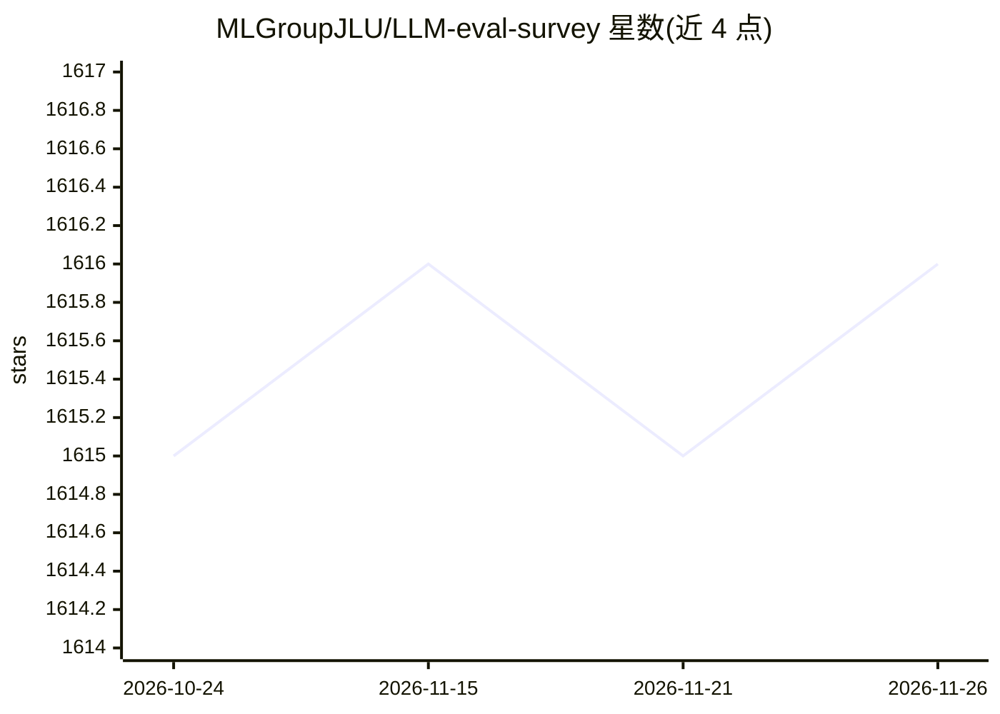

# MLGroupJLU/LLM-eval-survey

⭐ 1,616 · 推送 2026-11-18 · [GitHub](https://github.com/MLGroupJLU/LLM-eval-survey) · [官网](https://arxiv.org/abs/2307.03109) · 组织维护 · 中文 README

**面向研究者的 LLM 评测论文集合**

_survey on Evaluation of Large Language Models_ 论文的官方 GitHub 页面，按 survey 结构组织相关论文与资源清单："What to evaluate" 部分按自然语言处理（理解、推理、生成）、鲁棒性/伦理/可信性、社会科学、自然科学、医疗、Agent 等应用领域分类收录评测论文；"Where to evaluate" 部分收录基准相关资源。作者来自吉林大学、微软研究院等机构。仓库不接受实时更新 arXiv 论文，以仓库为最新更新来源，并接受 pull request 与 issue 贡献。

## 筛选速览

| 维度 | 判定 | 备注 |
|---|---|---|
| AI 角色 | `ai-knowledge` | 知识聚合/清单类 |
| 许可风险 | `none` | — |
| 部署形态 | `None` |  |
| 模型依赖 | — | README 未给出锁定关系 |
| 硬件要求 | — | 无带数字的原话,不猜 |
| 安装摩擦 | `low` | 无编译、无系统依赖或容器化 |
| 成熟度 | — | 结构信号不足 |

## 能力要点

- survey 论文的官方配套资源页
- 按评测对象（NLP/推理/生成/多语言/事实性）分类组织论文
- 另有 "Where to evaluate" 部分收录评测基准资源
- 持续更新并接受社区 PR/issue 贡献

## 适用场景

- 查找某任务/领域的 LLM 评测相关论文
- 了解 LLM 评测的研究分类框架
- 调研评测基准（Where to evaluate）相关资源

## 场景标签

`精选清单` · 领域:学习与行业

## 证据(README 行号)

> L1: LLM evaluation
> L2:  A collection of papers and resources related to evaluations on large language models.
> L33: The papers are organized according to our survey: A Survey on Evaluation of Large Language Models.
> L35: **NOTE:** As we cannot update the arXiv paper in real time, please refer to this repo for the latest updates and th

## 星数曲线

2026-10-24 1,615 → 2026-11-26 1,616（+1）

---
*卡片 v1 · prompt 1.4 · 生成 2026-11-24 · 置信度 high · 依据 README sha `b39a0fe1c015` · [字段定义](../../DATASET.md)*
