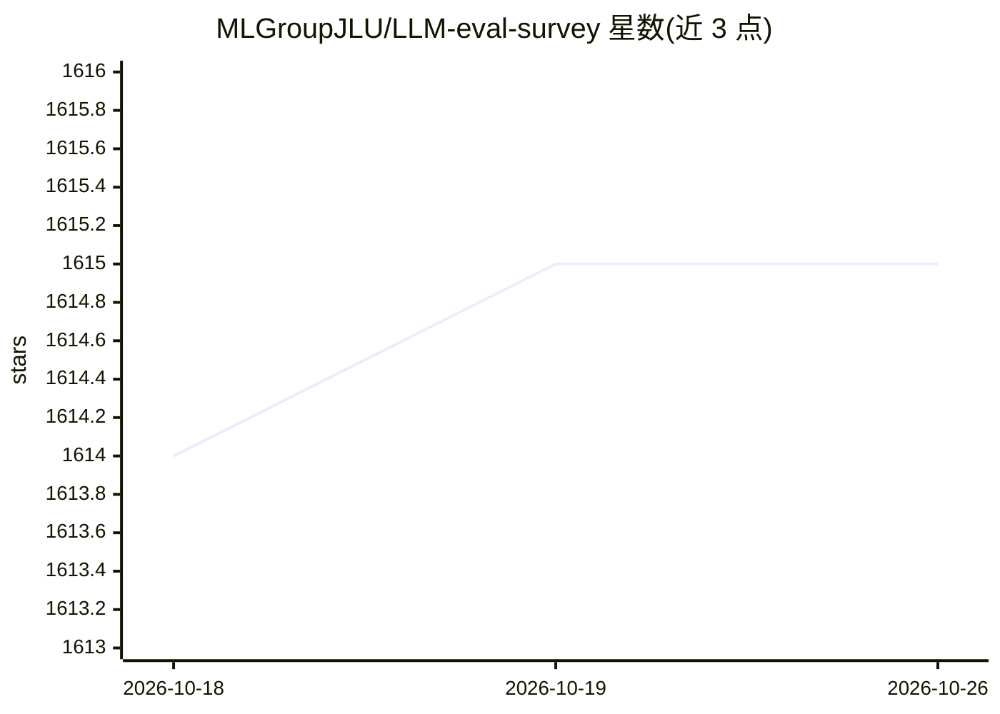

# MLGroupJLU/LLM-eval-survey

⭐ 1,615 · 推送 2026-10-21 · [GitHub](https://github.com/MLGroupJLU/LLM-eval-survey) · [官网](https://arxiv.org/abs/2307.03109) · 组织维护 · 中文 README

**LLM 评测论文与资源的策展清单（综述配套）**

综述论文 A Survey on Evaluation of Large Language Models 的官方仓库：按 NLP、鲁棒性/伦理/可信、社科、自然科学与工程、医疗、Agent 应用等类别收录 LLM 评测相关论文条目，每条含作者与论文链接；另列出 PromptBench、LLM-eval 等相关项目。仓库声明更新比 arXiv 版本更及时，接受 pull request 与 issue 贡献。面向查找 LLM 评测文献的研究者与开发者。

## 筛选速览

| 维度 | 判定 | 备注 |
|---|---|---|
| AI 角色 | `ai-knowledge` | 知识聚合/清单类 |
| 许可风险 | `none` | — |
| 部署形态 | `None` |  |
| 模型依赖 | — | README 未给出锁定关系 |
| 硬件要求 | — | 无带数字的原话,不猜 |
| 安装摩擦 | `low` | 无编译、无系统依赖或容器化 |
| 成熟度 | — | 结构信号不足 |

## 能力要点

- 配套综述论文，按'评测什么/在哪评测'组织目录
- 覆盖 NLU、推理、生成、多语言、事实性等十余个评测方向
- 收录相关项目链接（PromptBench、LLM-eval）

## 适用场景

- 查找 LLM 在特定任务上的评测论文
- 了解 LLM 评测研究的分类体系
- 跟踪综述的更新与补充文献

## 场景标签

`模型评测` `科研工具` `精选清单` · 领域:评测与运维

## 证据(README 行号)

> L2:  A collection of papers and resources related to evaluations on large language models.
> L33: The papers are organized according to our survey: A Survey on Evaluation of Large Language Models.

## 星数曲线

2026-10-18 1,614 → 2026-10-26 1,615（+1）

---
*卡片 v1 · prompt 1.4 · 生成 2026-10-21 · 置信度 high · 依据 README sha `fac23305e71c` · [字段定义](../../DATASET.md)*
