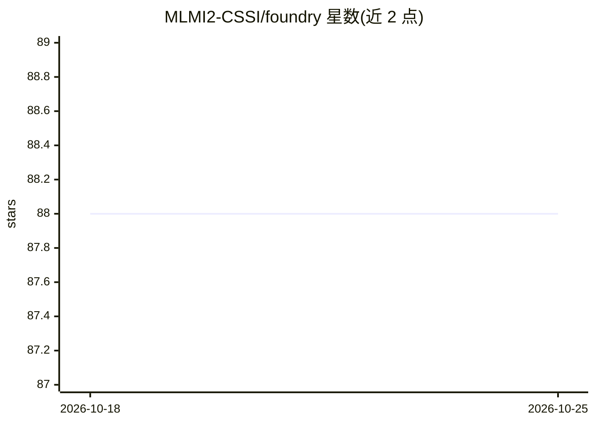

# MLMI2-CSSI/foundry

⭐ 88 · Python · MIT · 推送 2026-01-22 · [GitHub](https://github.com/MLMI2-CSSI/foundry) · 组织维护

**材料科学与化学领域的机器学习就绪数据集发现与加载库**

Foundry-ML 是面向材料科学与化学研究者的 Python 库，用于查找、加载与发布机器学习就绪数据集：支持按关键词、DOI 搜索或浏览目录，自动完成下载、缓存与格式转换，提供描述字段含义的 schema 与自动引文生成，并可将数据集导出为 PyTorch/TensorFlow 格式（可选扩展）或发布至 HuggingFace Hub。另提供 CLI 与 MCP server，供 Claude 等 AI 助手接入。注意 PyTorch/TensorFlow 扩展依赖 NumPy 2.0 兼容构建。

## 筛选速览

| 维度 | 判定 | 备注 |
|---|---|---|
| AI 角色 | `ai-ecosystem` | LLM/agent 周边工具 |
| 许可风险 | `permissive` | MIT |
| 部署形态 | `library` | 以包/库形式分发 |
| 模型依赖 | — | README 未给出锁定关系 |
| 硬件要求 | — | 无带数字的原话,不猜 |
| 安装摩擦 | `low` | 无编译、无系统依赖或容器化 |
| 成熟度 | — | 结构信号不足 |

## 能力要点

- 按关键词/DOI 搜索并自动下载、缓存与格式转换数据集
- PyTorch/TensorFlow 可选扩展（get_as_torch/get_as_tensorflow）
- MCP server 支持 Claude 等 AI 助手接入
- 自动引文生成与 HuggingFace Hub 导出（可选）

## 适用场景

- 为材料机器学习项目快速获取带 schema 的就绪数据集
- 在论文中规范引用所用数据集
- 让 AI 助手通过 MCP 直接检索数据集

## 场景标签

 · 领域:材料科学/化学·数据平台

## 证据(README 行号)

> L5: **Foundry-ML** simplifies access to machine learning-ready datasets in materials science and chemistry.
> L74: |MCP Server|AI assistant integration|

## 星数曲线

2026-10-18 88 → 2026-10-25 88（+0）

---
*卡片 v1 · prompt 1.4 · 生成 2026-10-23 · 置信度 high · 依据 README sha `ad6626206e63` · [字段定义](../../DATASET.md)*
