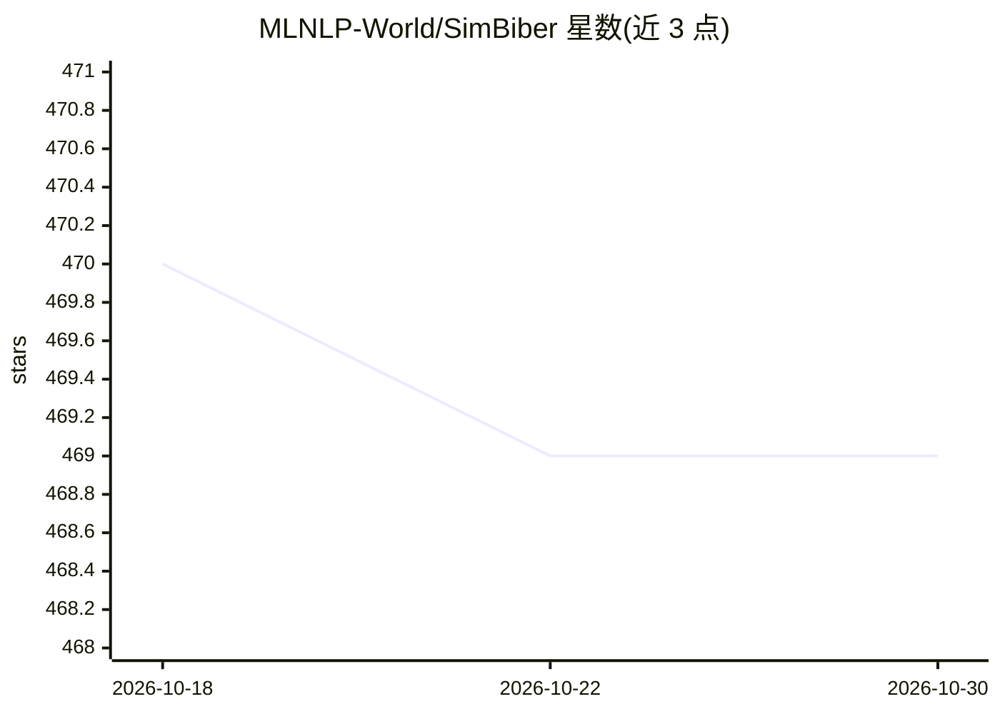

# MLNLP-World/SimBiber

⭐ 469 · Python · MIT · 推送 2026-01-20 · [GitHub](https://github.com/MLNLP-World/SimBiber) · 组织维护

**给论文作者：把 BibTeX 参考文献精简为官方简称格式**

Python 命令行工具，读取 .bib 文件或目录，依据内置映射配置把会议/期刊全称替换为官方简称（如 Association for Computational Linguistics→ACL），仅保留作者、标题、会议名等必要字段，以应对论文页数限制。支持自定义保留字段、arXiv 与会议版本去重、文件夹批处理，映射覆盖 AI/CV/DM/IR/ML/NLP 六类百余个会议。提供 pip 安装与 Hugging Face Space 在线使用。README 声明项目较新、结果不保证严格符合官方规范，建议人工复核。

## 筛选速览

| 维度 | 判定 | 备注 |
|---|---|---|
| AI 角色 | `ai-enhanced` | 去掉 AI 部分产品仍成立 |
| 许可风险 | `permissive` | MIT |
| 部署形态 | `library` | 以包/库形式分发 |
| 模型依赖 | — | README 未给出锁定关系 |
| 硬件要求 | — | 无带数字的原话,不猜 |
| 安装摩擦 | `low` | 无编译、无系统依赖或容器化 |
| 成熟度 | `idea` | |

## 能力要点

- 会议/期刊全称到官方简称的映射替换（覆盖百余个会议，六大学科分类）
- 支持只保留指定字段（-keep）、按文件夹批量精简、arXiv/会议条目去重
- pip 安装命令行使用，另有 Hugging Face Space 在线入口

## 适用场景

- 论文投稿页数受限时精简参考文献
- 批量整理项目目录下所有 .bib 文件
- 配合 Rebiber 先规范化再精简 BibTeX

## 场景标签

`科研工具` · 领域:学习与行业

## 证据(README 行号)

> L36: We often need to simplify the official bib that consists of many information into a shorter version that only maint
> L38: We introduce __SimBiber__, a simple tool in Python to simplify them automatically. Hope it's helpful for you.

## 星数曲线

2026-10-18 470 → 2026-10-30 469（-1）

---
*卡片 v1 · prompt 1.4 · 生成 2026-10-21 · 置信度 low · 依据 README sha `7883e10c682a` · [字段定义](../../DATASET.md)*
