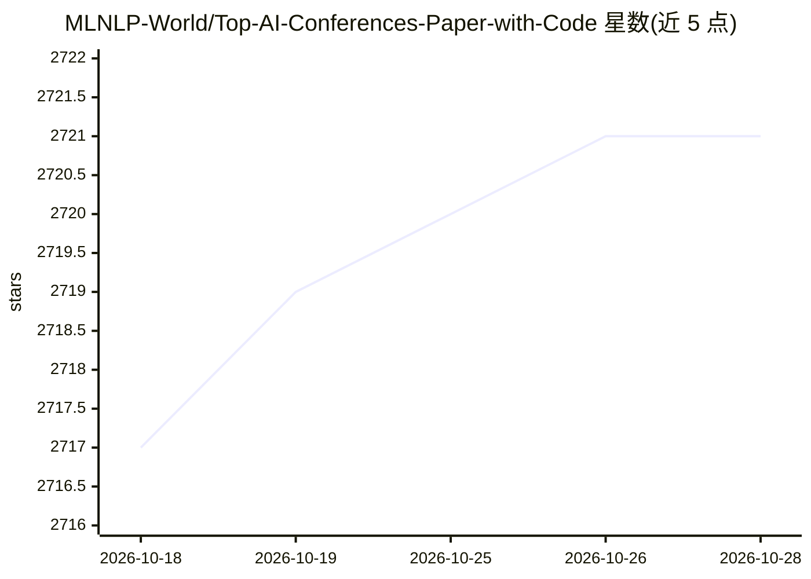

# MLNLP-World/Top-AI-Conferences-Paper-with-Code

⭐ 2,721 · 推送 2026-07-02 · [GitHub](https://github.com/MLNLP-World/Top-AI-Conferences-Paper-with-Code) · 组织维护 · 中文 README

**AI 顶会论文与开源代码的配对整理清单**

由 MLNLP 社区维护的论文清单仓库：收集 ACL、EMNLP、NAACL、COLING、AAAI、IJCAI、ICLR、NeurIPS、ICML 等 AI 会议中带开源代码的论文，按会议与年份（2018/2019-2026）组织条目，便于检索、跟进与复现。数据部分来源于 DBLP、ACL、NIPS、OpenReview 和 paperwithcode，接受 issue 与 PR 贡献。仓库处于持续建设状态（v0.1.0），无安装或运行流程，属于纯阅读与查阅资源。

## 筛选速览

| 维度 | 判定 | 备注 |
|---|---|---|
| AI 角色 | `ai-knowledge` | 知识聚合/清单类 |
| 许可风险 | `none` | — |
| 部署形态 | `None` |  |
| 模型依赖 | — | README 未给出锁定关系 |
| 硬件要求 | — | 无带数字的原话,不猜 |
| 安装摩擦 | `low` | 无编译、无系统依赖或容器化 |
| 成熟度 | `idea` | |

## 能力要点

- 覆盖 9 个 AI 顶会的论文与开源代码配对条目
- 按会议和年份组织，多数会议覆盖至 2025，ICLR 含 2026
- 接受 issue/PR 社区贡献

## 适用场景

- 查找某顶会某年份带代码的论文
- 复现论文时定位配套开源实现
- 跟踪 AI 顶会开源论文动态

## 场景标签

`精选清单` · 领域:学习与行业

## 证据(README 行号)

> L24: 本仓库收集了 AI 顶会论文及其 **开源代码资源**，包括 ACL、EMNLP、NAACL、COLING、AAAI、IJCAI、ICLR、NeurIPS 和 ICML 等会议。
> L37: |会议|2019|2020|2021|2022|2023|2024|2025|2026|

## 星数曲线

2026-10-18 2,717 → 2026-10-28 2,721（+4）

---
*卡片 v1 · prompt 1.4 · 生成 2026-10-21 · 置信度 high · 依据 README sha `44f4e68fbfc8` · [字段定义](../../DATASET.md)*
