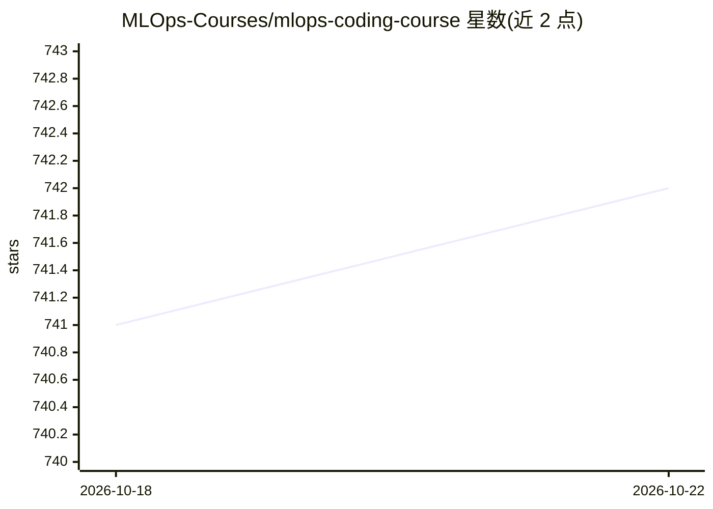

# MLOps-Courses/mlops-coding-course

⭐ 743 · CC-BY-4.0 · 推送 2026-10-19 · [GitHub](https://github.com/MLOps-Courses/mlops-coding-course) · [官网](https://mlops-coding-course.fmind.dev/) · 组织维护

**教你构建与维护 MLOps 代码库的实践课程（教程）**

面向初学者与有经验工程师的 MLOps 编程课程，以 Python 为载体讲授 ML/AI 项目从初始化、原型、生产化、验证、CI/CD 与模型注册、文档到可观测性的完整流程。每章带检查点与思考题，介绍 uv、Ruff、pytest、MLflow、mise、lefthook 等开源工具；仓库内含可在本地合成数据上运行的两个实验，无需数据集下载或云账户。另提供付费的一对一辅导（$10/月编程助手）与 MLOps Python 包模板等相关资源。

## 筛选速览

| 维度 | 判定 | 备注 |
|---|---|---|
| AI 角色 | `ai-knowledge` | 知识聚合/清单类 |
| 许可风险 | `viral` | CC-BY-4.0 |
| 部署形态 | `None` |  |
| 模型依赖 | — | README 未给出锁定关系 |
| 硬件要求 | — | 无带数字的原话,不猜 |
| 安装摩擦 | `low` | 无编译、无系统依赖或容器化 |
| 成熟度 | — | 结构信号不足 |

## 能力要点

- 课程覆盖初始化到可观测性的 7 个 MLOps 阶段，每章含检查点
- 仓库内置两个可本地运行的实验（mise run test），无需数据集或云账户
- 介绍 uv、Ruff、pytest、MLflow、mise、lefthook 等工具链
- 本地文档站基于 Zensical 构建，mise 驱动全部开发任务

## 适用场景

- 系统学习 MLOps 项目从原型到部署维护的编码实践
- 在本地跑通课程附带实验并逐步复现各章节
- 为自己的 ML 项目寻找可参考的工程化工具链与配置

## 场景标签

`教程课程` `MLOps` · 领域:学习与行业

## 证据(README 行号)

> L5: This course is designed to dive deep into the intersection of software development and data science, focusing on the
> L30: 1. **Initializing**: Set up your development environment, manage Python versions, and handle external dependencies.

## 星数曲线

2026-10-18 741 → 2026-10-22 742（+1）

---
*卡片 v1 · prompt 1.4 · 生成 2026-10-21 · 置信度 high · 依据 README sha `dc741c469a9c` · [字段定义](../../DATASET.md)*
