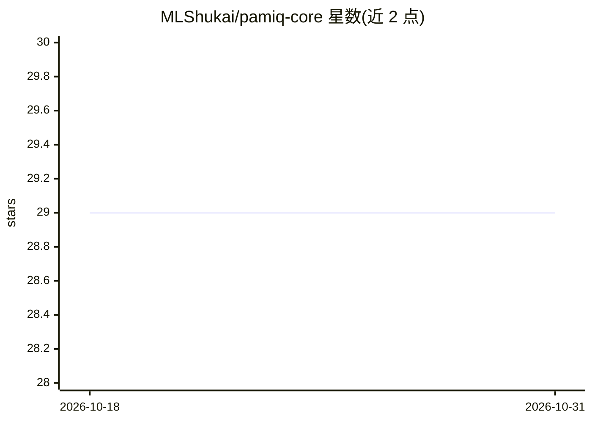

# MLShukai/pamiq-core

⭐ 29 · Python · MIT · 推送 2026-05-12 · [GitHub](https://github.com/MLShukai/pamiq-core) · [官网](https://mlshukai.github.io/pamiq-core/) · 组织维护

**构建实时自适应学习 AI agent 的 Python 框架**

面向构建具有实时自适应（持续）学习能力 AI agent 的最小化机器学习框架：以多线程架构实现推理与训练并行执行，训练线程可在 agent 交互过程中持续更新模型；内置线程安全的参数共享、经验数据自动缓冲、状态持久化与监控工具，兼容 Gymnasium 环境，提供 pamiq-console 远程 CLI 控制。要求 Python 3.12+，PyTorch 为可选集成，Linux 为主要支持平台（Windows/macOS 亦支持，但部分旧系统时间控制精度较低）。

## 筛选速览

| 维度 | 判定 | 备注 |
|---|---|---|
| AI 角色 | `ai-ecosystem` | LLM/agent 周边工具 |
| 许可风险 | `permissive` | MIT |
| 部署形态 | `library` | 以包/库形式分发 |
| 模型依赖 | — | README 未给出锁定关系 |
| 硬件要求 | — | 无带数字的原话,不猜 |
| 安装摩擦 | `low` | 无编译、无系统依赖或容器化 |
| 成熟度 | — | 结构信号不足 |

## 能力要点

- 推理与训练分线程并行的架构
- 线程安全的模型参数共享与数据传输
- 内置状态持久化、时间控制与监控
- pamiq-console 远程 CLI 控制运行中的系统

## 适用场景

- 构建边交互边训练的持续学习 agent
- 在 Gymnasium 环境中做实时自适应 RL 实验
- 远程连接并控制运行中的学习系统

## 场景标签

`Agent 框架` `强化学习` · 领域:Agent 开发

## 证据(README 行号)

> L13: **pamiq-core** is a minimal machine learning framework for asynchronous execution of inference and training.
> L27: - 🔄 **Parallel Architecture**: Simultaneous inference and training in separate threads

## 星数曲线

2026-10-18 29 → 2026-10-31 29（+0）

---
*卡片 v1 · prompt 1.4 · 生成 2026-10-26 · 置信度 high · 依据 README sha `cbb40e333089` · [字段定义](../../DATASET.md)*
