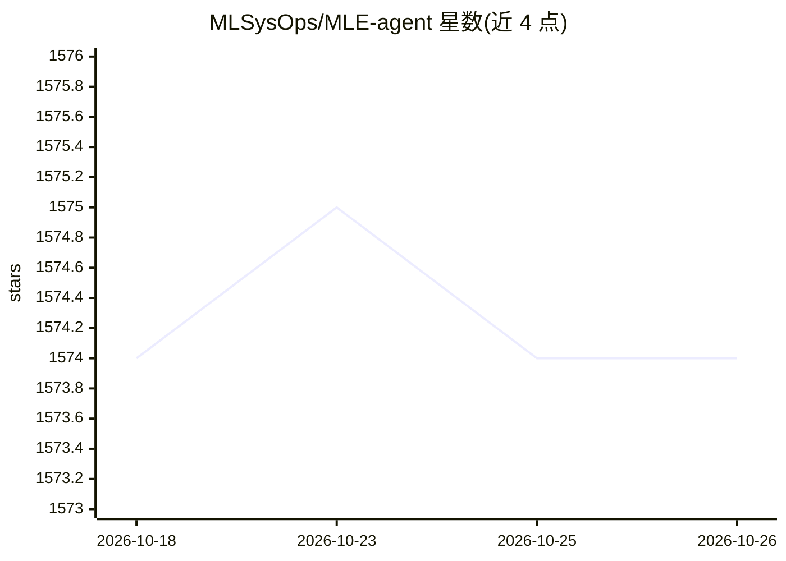

# MLSysOps/MLE-agent

⭐ 1,574 · Python · MIT · 推送 2026-07-10 · [GitHub](https://github.com/MLSysOps/MLE-agent) · 组织维护

**面向机器学习工程师与研究者的配对 LLM 智能体**

MLE-Agent 是为机器学习工程师和研究者设计的命令行 LLM 代理：根据需求自动搭建 ML/AI 基线并本地测试，可自主完成 Kaggle 竞赛从数据准备到模型训练的编码与调试，集成 arXiv 与 Papers with Code 获取最新方法，支持自动调试器-编码器交互、文件系统组织、周报生成（Web 与本地 Git 两种模式）及终端交互式聊天。支持 OpenAI、Anthropic、Gemini、Ollama 等多种模型，通过 PyPI 安装，以 mle 系列命令驱动各功能。

## 筛选速览

| 维度 | 判定 | 备注 |
|---|---|---|
| AI 角色 | `ai-native` | 本体是模型或模型工具 |
| 许可风险 | `permissive` | MIT |
| 部署形态 | `library` | 以包/库形式分发 |
| 模型依赖 | — | README 未给出锁定关系 |
| 硬件要求 | — | 无带数字的原话,不猜 |
| 安装摩擦 | `low` | 无编译、无系统依赖或容器化 |
| 成熟度 | — | 结构信号不足 |

## 能力要点

- 根据需求自动生成 ML/AI 基线并在本地机器测试
- 自主参与 Kaggle 竞赛（含 --auto 无人交互模式）
- 集成 arXiv 与 Papers with Code 获取最佳实践
- 从 GitHub 或本地 Git 仓库自动生成周报

## 适用场景

- 我想要快速搭一个股票预测之类的 ML 基线原型
- 让 agent 独立完成 Kaggle 竞赛的编码与调试
- 自动汇总本周开发进度生成工作报告

## 场景标签

`编码 Agent` `MLOps` · 领域:编码与开发

## 证据(README 行号)

> L17: MLE-Agent is designed as a pairing LLM agent for machine learning engineers and researchers. It is featured by:
> L19: - 🤖 Autonomous Baseline: Automatically builds ML/AI baselines and solutions based on your requirements.
> L141: MLE agent can participate in Kaggle competitions and finish coding and debugging from data preparation to model tr

## 星数曲线

2026-10-18 1,574 → 2026-10-26 1,574（+0）

---
*卡片 v1 · prompt 1.4 · 生成 2026-10-21 · 置信度 high · 依据 README sha `2712c8f6d958` · [字段定义](../../DATASET.md)*
