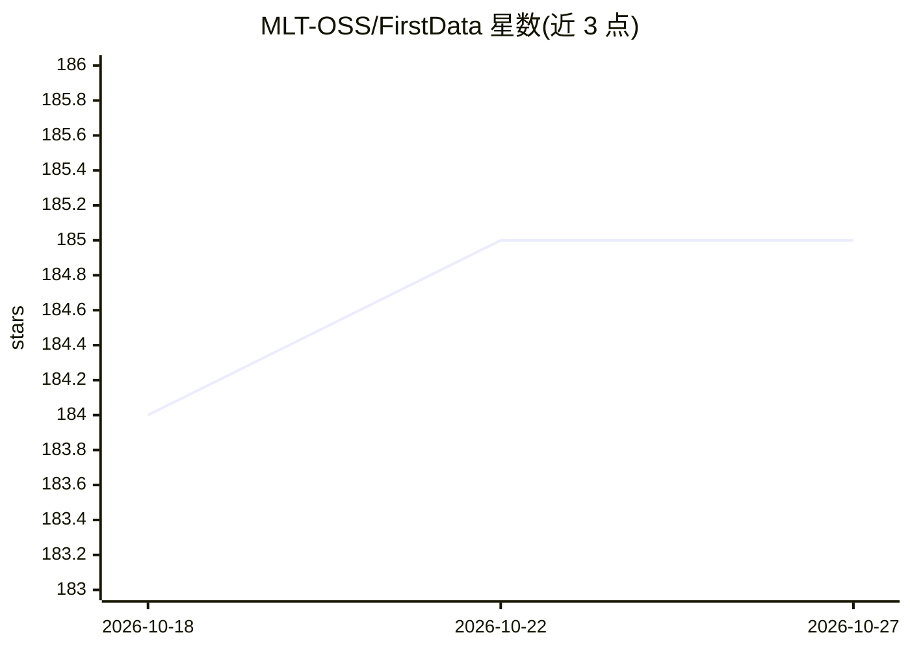

# MLT-OSS/FirstData

⭐ 185 · Python · MIT · 推送 2026-10-03 · [GitHub](https://github.com/MLT-OSS/FirstData) · [官网](https://firstdata.deepminer.com.cn) · 组织维护 · 中文 README

**面向 AI Agent 的权威数据源知识库与 MCP 检索服务**

聚合跨领域高可信数据源（政府、国际组织、学术机构、行业权威）构建结构化外部事实上下文层：每条数据源含唯一 ID、双语描述、访问 URL、API 信息、权威等级（government/international/research/market/commercial/other）等元数据，URL 经验证。在此基础上提供 FirstData MCP Server：基于自然语言推荐 Top 3-5 权威数据源，并内置专业网站逐步操作导航说明书。接入方式包括 Agent Skill 一键安装（clawhub install firstdata）与手动 MCP 配置，需申请免费 API Key，支持 Claude Desktop、Cline、Cursor 等 MCP 兼容平台。规划收录 1000+ 数据源，其中含 500+ 中国政府数据源。

## 筛选速览

| 维度 | 判定 | 备注 |
|---|---|---|
| AI 角色 | `ai-knowledge` | 知识聚合/清单类 |
| 许可风险 | `permissive` | MIT |
| 部署形态 | `None` |  |
| 模型依赖 | — | README 未给出锁定关系 |
| 硬件要求 | — | 无带数字的原话,不猜 |
| 安装摩擦 | `low` | 无编译、无系统依赖或容器化 |
| 成熟度 | — | 结构信号不足 |

## 能力要点

- 结构化元数据体系：唯一ID、双语描述、API信息、权威等级、更新频率等
- FirstData MCP：自然语言推荐权威数据源并给出检索理由与证据链
- 网站操作导航（Site Pathfinder）：逐步操作指引、主路径+备选方案
- Agent Skill 自动注册激活与 MCP 配置，零人工介入接入

## 适用场景

- 让 AI Agent 在回答前定位政府、国际组织等一手权威数据源
- 研究人员快速找到特定领域（GDP、气候、招股书）的权威数据来源
- 为复杂官方网站获取手把手的检索操作路径说明

## 场景标签

`精选清单` · 领域:学习与行业

## 证据(README 行号)

> L28: 本项目旨在构建一个**面向 AI Agent 的、全球的、权威的、结构化的外部事实上下文层（External Facts Context Layer）**。
> L62: |🔌**MCP协议集成**|提供标准MCP Server，可集成到Claude Desktop、Cline等AI应用|让任何AI应用都能访问权威外部事实上下文层|
> L134: ## 🎯FirstData MCP

## 星数曲线

2026-10-18 184 → 2026-10-27 185（+1）

---
*卡片 v1 · prompt 1.4 · 生成 2026-10-22 · 置信度 high · 依据 README sha `1ebfafddc549` · [字段定义](../../DATASET.md)*
