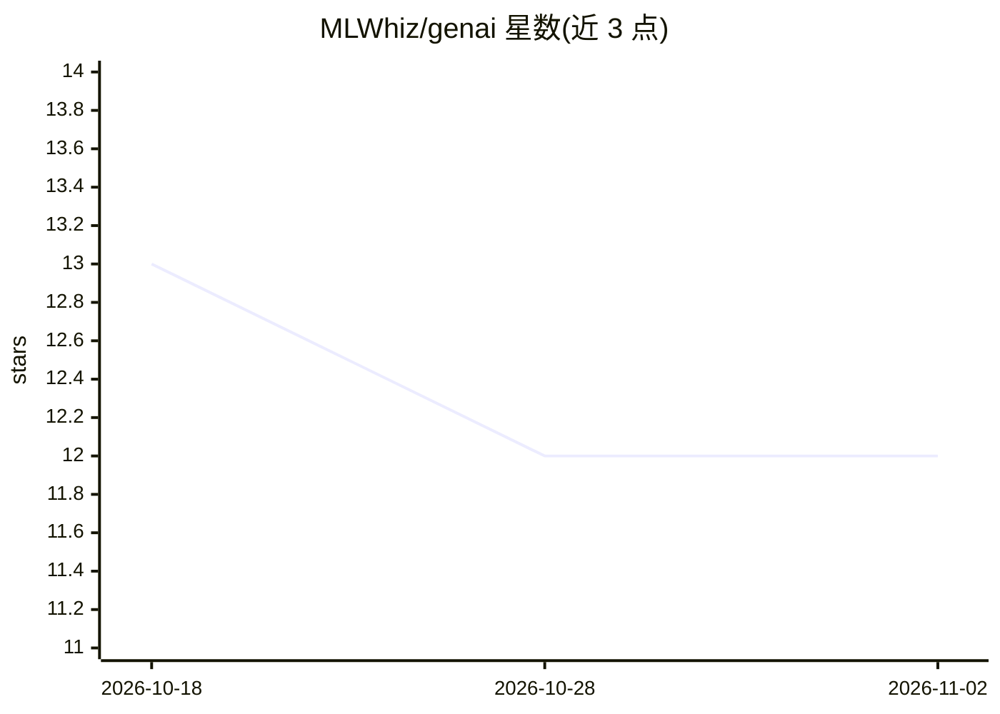

# MLWhiz/genai

⭐ 12 · Jupyter Notebook · 推送 2026-10-14 · [GitHub](https://github.com/MLWhiz/genai) · 个人维护

**生成式 AI 系列博文的配套资源库：论文、代码与书籍清单**

MLWhiz 作者的 Generative AI 系列博文配套仓库：收录 15 篇博文的目录（架构演进、提示工程、RAG 与 GraphRAG、PEFT 微调、AI 辅助开发等），每篇博文对应文件夹与 README，含代码处提供链接。另含 48 篇研究论文整理（12 篇架构演进 + 36 篇 GenAIPapers 分类合集）、GenAI 书籍与课程资源、4 个实践 notebook。面向学习生成式 AI 的 ML 工程师与开发者，以 Jupyter notebook 与文档形式组织，MIT 许可。

## 筛选速览

| 维度 | 判定 | 备注 |
|---|---|---|
| AI 角色 | `ai-knowledge` | 知识聚合/清单类 |
| 许可风险 | `none` | — |
| 部署形态 | `None` |  |
| 模型依赖 | — | README 未给出锁定关系 |
| 硬件要求 | — | 无带数字的原话,不猜 |
| 安装摩擦 | `low` | 无编译、无系统依赖或容器化 |
| 成熟度 | — | 结构信号不足 |

## 能力要点

- 15 篇系列博文，每篇带独立 README 与代码链接
- 48 篇研究论文的 8 类整理（架构/推理/微调/多模态/对齐/RAG 等）
- 覆盖 RAG、GraphRAG、LoRA/QLoRA 等 PEFT 方法的实践 notebook
- GenAI 书籍与 Google GenAI 课程资源合集

## 适用场景

- 系统学习生成式 AI 从架构到微调的知识脉络
- 查找 RAG/GraphRAG/PEFT 的动手实现代码
- 按类别检索生成式 AI 领域重要论文

## 场景标签

`教程课程` `精选清单` · 领域:学习与行业

## 证据(README 行号)

> L7: This repository serves as a comprehensive collection of code examples, research papers, and practical resources from
> L93: A comprehensive collection of 36 most influential research papers in Generative AI:

## 星数曲线

2026-10-18 13 → 2026-11-02 12（-1）

---
*卡片 v1 · prompt 1.4 · 生成 2026-11-01 · 置信度 high · 依据 README sha `112dccaa7663` · [字段定义](../../DATASET.md)*
