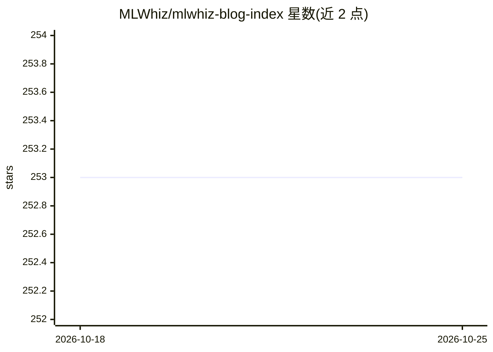

# MLWhiz/mlwhiz-blog-index

⭐ 253 · Jupyter Notebook · 推送 2026-10-14 · [GitHub](https://github.com/MLWhiz/mlwhiz-blog-index) · [官网](https://medium.com/@rahul_agarwal) · 个人维护

**MLWhiz 博客文章配套代码索引仓库**

作者 MLWhiz 用于归档其博客文章配套代码的个人仓库：新版系列文章（RecSys 12 篇、GenAI Fundamentals 5 篇、Generative AI 15 篇、ML Careers 6 篇）每系列各自独立仓库，本 README 仅提供索引；旧版文章（深度学习、数据科学、大数据）的代码存于本仓库内。条目以表格形式列出文章标题、博客链接与代码链接，ML Careers 系列无代码仅附文字总结。无安装或运行说明。

## 筛选速览

| 维度 | 判定 | 备注 |
|---|---|---|
| AI 角色 | `ai-knowledge` | 知识聚合/清单类 |
| 许可风险 | `none` | — |
| 部署形态 | `None` |  |
| 模型依赖 | — | README 未给出锁定关系 |
| 硬件要求 | — | 无带数字的原话,不猜 |
| 安装摩擦 | `low` | 无编译、无系统依赖或容器化 |
| 成熟度 | — | 结构信号不足 |

## 能力要点

- 按系列组织的博文与代码链接索引（新版文章代码在各自独立仓库）
- 覆盖推荐系统、GenAI/RAG、深度学习、数据科学、Spark/大数据等主题
- 附带免费 CS 与数据科学课程资源清单

## 适用场景

- 按主题查找 MLWhiz 博客文章及其配套代码位置
- 了解推荐系统与 GenAI 系列博文的覆盖范围
- 获取免费 CS/数据科学课程资源清单

## 场景标签

`精选清单` · 领域:学习与行业

## 证据(README 行号)

> L1: # MLWhiz Blog Index
> L5: So I thought of creating a repository to keep track of all the code that I end up writing for my blog posts.
> L10: Each series has its own repo. Code links point to the folder for that post. The ML Careers posts have no code, so t

## 星数曲线

2026-10-18 253 → 2026-10-25 253（+0）

---
*卡片 v1 · prompt 1.4 · 生成 2026-10-22 · 置信度 high · 依据 README sha `691a105b2039` · [字段定义](../../DATASET.md)*
