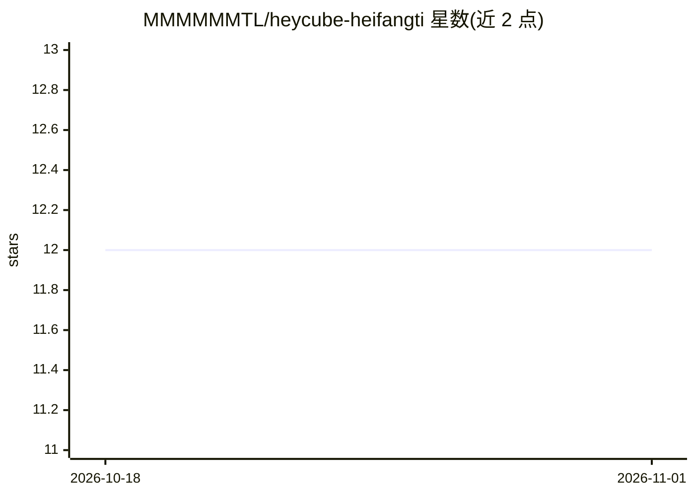

# MMMMMMTL/heycube-heifangti

⭐ 12 · Python · MIT · 推送 2026-03-14 · [GitHub](https://github.com/MMMMMMTL/heycube-heifangti) · [官网](https://heifangti.com) · 个人维护 · 中文 README

**为 OpenClaw 打造的结构化 AI 记忆层：本地存储、按需加载个人档案**

HeyCube（黑方体）是 OpenClaw 的记忆层插件：通过 Pre/Post Hook 在对话前语义分析并从 500+ 维度中选取相关项，从本地 SQLite 查询后注入上下文（约 2K tokens），对话后自动提取结构化数据写回。个人数据（对话原文、结构化档案）存于本地，服务端仅存维度 ID 与字段数等元数据，并提供维度概念池维护。定位与 OpenClaw 原生 MEMORY.md 互补而非替代。使用需注册账号生成 API Key，服务端采用 PostgreSQL 与 Embedding 向量检索。

## 筛选速览

| 维度 | 判定 | 备注 |
|---|---|---|
| AI 角色 | `ai-ecosystem` | LLM/agent 周边工具 |
| 许可风险 | `permissive` | MIT |
| 部署形态 | `None` |  |
| 模型依赖 | — | README 未给出锁定关系 |
| 硬件要求 | — | 无带数字的原话,不猜 |
| 安装摩擦 | `low` | 无编译、无系统依赖或容器化 |
| 成熟度 | — | 结构信号不足 |

## 能力要点

- 8 大域分类的结构化人格档案，维度持续扩展
- Pre/Post Hook 按需加载，单次约 2000 tokens
- 对话原文与档案均存本地 SQLite，服务端仅元数据
- 多路召回与 SQL 精准查询结合的智能召回

## 适用场景

- 让 OpenClaw 助手跨会话记住偏好与决策风格
- 控制长记忆带来的上下文 token 消耗
- 在本地保留 AI 记忆数据并按需导出 CSV/Markdown

## 场景标签

`Agent 记忆` · 领域:Agent 开发

## 证据(README 行号)

> L9:  为 OpenClaw 打造的结构化个人档案管理方案
> L74: OpenClaw 的 Pre/Post Hook 机制让它零侵入运行：

## 星数曲线

2026-10-18 12 → 2026-11-01 12（+0）

---
*卡片 v1 · prompt 1.4 · 生成 2026-11-01 · 置信度 high · 依据 README sha `9f8f040663b7` · [字段定义](../../DATASET.md)*
