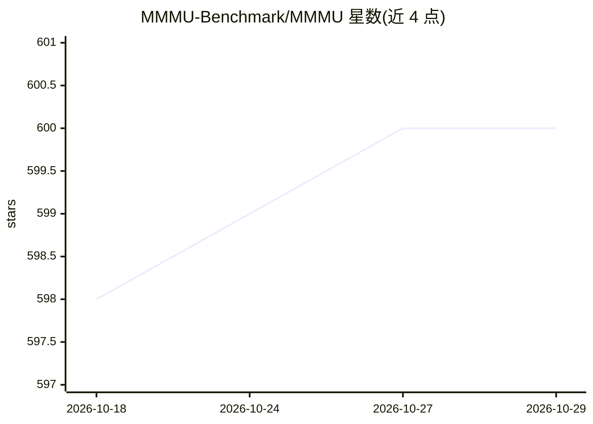

# MMMU-Benchmark/MMMU

⭐ 600 · Python · Apache-2.0 · 推送 2026-07-28 · [GitHub](https://github.com/MMMU-Benchmark/MMMU) · [官网](https://mmmu-benchmark.github.io/) · 组织维护 · 中文 README

**多模态模型的多学科理解与推理评测基准（MMMU/MMMU-Pro）**

MMMU 及其加强版 MMMU-Pro 的官方评测代码仓库，配套 Hugging Face 数据集。MMMU 收录 11.5K 道来自大学考试、测验与教材的多模态题目，覆盖 6 大学科、30 个科目、183 个子领域与 32 种图像类型，用于评测多模态模型的专业知识与推理能力。数据集分为 150 道开发样本、900 道验证样本与 10,500 道测试样本，测试集答案已发布，可本地评测；另有社区维护的 EvalScope 第三方评测工作流，支持对 OpenAI 兼容端点运行评测。

## 筛选速览

| 维度 | 判定 | 备注 |
|---|---|---|
| AI 角色 | `ai-knowledge` | 知识聚合/清单类 |
| 许可风险 | `permissive` | Apache-2.0 |
| 部署形态 | `None` |  |
| 模型依赖 | — | README 未给出锁定关系 |
| 硬件要求 | — | 无带数字的原话,不猜 |
| 安装摩擦 | `low` | 无编译、无系统依赖或容器化 |
| 成熟度 | — | 结构信号不足 |

## 能力要点

- 11.5K 多模态题目，覆盖 6 大学科、30 科目、183 子领域、32 种图像类型
- 测试集答案已发布，可使用官方流水线本地评测
- MMMU-Pro 采用三步构建：过滤纯文本可答题目、扩充候选项、纯视觉输入设置
- 提供社区维护的 EvalScope 第三方评测工作流

## 适用场景

- 评测多模态模型在大学级学科知识与推理上的表现
- 用验证集调试模型与选择超参数
- 通过官方流水线或 EvalScope 生成排行榜可比的本地评测结果

## 场景标签

`模型评测` `多模态` · 领域:评测与运维

## 证据(README 行号)

> L5: This repo contains the evaluation code for the paper "MMMU-Pro: A More Robust Multi-discipline Multimodal Understand
> L19: MMMU is a new benchmark designed to evaluate multimodal models on massive multi-discipline tasks demanding college-

## 星数曲线

2026-10-18 598 → 2026-10-29 600（+2）

---
*卡片 v1 · prompt 1.4 · 生成 2026-10-21 · 置信度 high · 依据 README sha `cc015d9d30db` · [字段定义](../../DATASET.md)*
