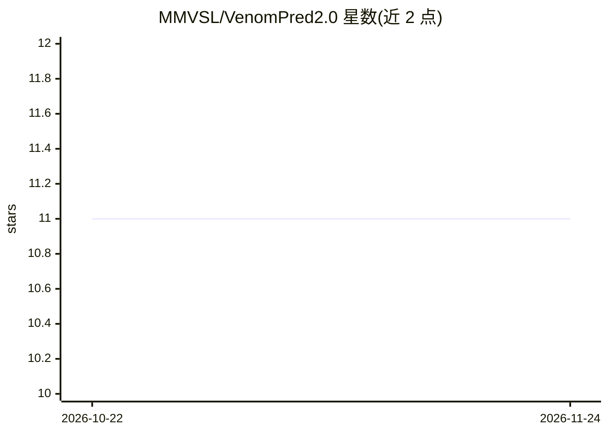

# MMVSL/VenomPred2.0

⭐ 11 · 推送 2026-07-07 · [GitHub](https://github.com/MMVSL/VenomPred2.0) · [官网](http://www.mmvsl.it/wp/venompred2/) · 组织维护

**小分子毒理学性质的机器学习预测平台**

VenomPred 2.0 是一个基于机器学习共识策略的平台，用于评估一个或多个小分子的毒理学概况，底层使用 RDKit。获取方式有两条：随 MolBook Pro 软件提供（可申请演示版），或通过网页直接在线访问；README 未给出本地安装命令、源码或 API 使用文档。README 信息以平台用途与访问入口为主，未展开具体模型、指标或使用限制。

## 筛选速览

| 维度 | 判定 | 备注 |
|---|---|---|
| AI 角色 | `ai-native` | 本体是模型或模型工具 |
| 许可风险 | `none` | — |
| 部署形态 | `None` |  |
| 模型依赖 | — | README 未给出锁定关系 |
| 硬件要求 | — | 无带数字的原话,不猜 |
| 安装摩擦 | `low` | 无编译、无系统依赖或容器化 |
| 成熟度 | — | 结构信号不足 |

## 能力要点

- 以机器学习共识策略评估小分子毒理学概况
- 基于 RDKit 构建
- 提供在线访问页面
- 集成于 MolBook Pro 软件中

## 适用场景

- 在线评估小分子的毒性特征
- 批量评估多个分子的毒理学概况
- 通过 MolBook Pro 软件在化学信息学工作流中调用

## 场景标签

 · 领域:化学信息学/毒性预测

## 证据(README 行号)

> L6: **VenomPred 2.0** platform allows you, through an innovative machine learning consensus strategy, to evaluate the **
> L8: ## **Venompred 2.0** is available within the MolBook Pro software.

## 星数曲线

2026-10-22 11 → 2026-11-24 11（+0）

---
*卡片 v1 · prompt 1.4 · 生成 2026-11-19 · 置信度 mid · 依据 README sha `52c242c0a56c` · [字段定义](../../DATASET.md)*
