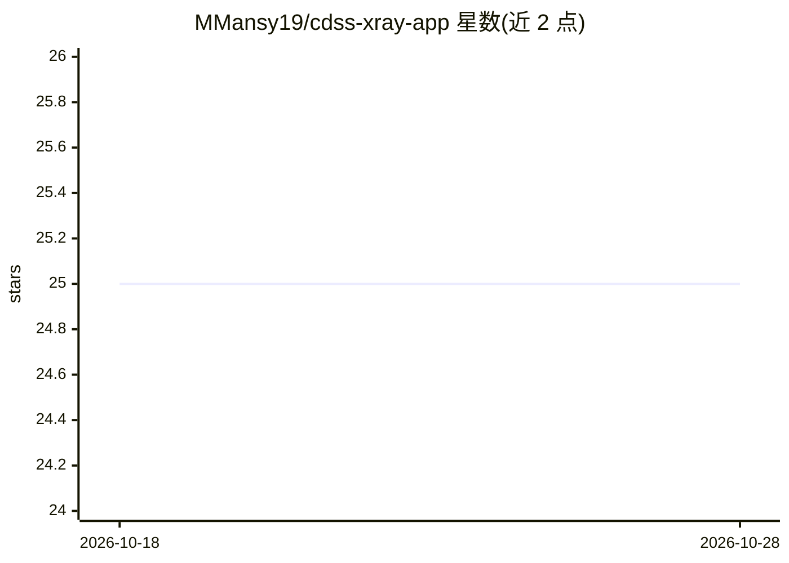

# MMansy19/cdss-xray-app

⭐ 25 · TypeScript · 推送 2026-10-23 · [GitHub](https://github.com/MMansy19/cdss-xray-app) · [官网](https://cdss-xray-app.vercel.app) · 个人维护

**胸部 X 光肺炎检测的临床决策支持全栈应用**

面向医疗场景的全栈 Web 应用：上传胸部 X 光片后，CNN 模型（基于 Kaggle 胸片数据集约 5,000 张训练，准确率 89.9%）给出肺炎等病变的诊断建议、置信度分数与热力图；结合患者体温、血压、心率与症状输入做综合诊断、严重度分级（低/中/高）与治疗建议。技术栈为 Next.js 15.3 + Django 4.2 + TensorFlow/PyTorch，支持 demo 与后端两种运行模式。README 声明仅用于教育与演示目的，临床使用前需专业人员审核。

## 筛选速览

| 维度 | 判定 | 备注 |
|---|---|---|
| AI 角色 | `ai-native` | 本体是模型或模型工具 |
| 许可风险 | `none` | — |
| 部署形态 | `None` |  |
| 模型依赖 | — | README 未给出锁定关系 |
| 硬件要求 | — | 无带数字的原话,不猜 |
| 安装摩擦 | `low` | 无编译、无系统依赖或容器化 |
| 成熟度 | — | 结构信号不足 |

## 能力要点

- CNN 模型检测肺炎并输出置信度与热力图
- 结合患者生命体征的综合诊断与低/中/高严重度分级
- 三层架构：Next.js 前端 + Django 后端 + AI 分析服务
- 支持无后端的 demo 模式与 JWT 认证

## 适用场景

- 上传胸片获得肺炎诊断建议与热力图
- 结合患者生命体征生成综合诊断与治疗建议
- 作为课程/教学演示项目学习全栈 AI 医疗应用开发

## 场景标签

`目标检测` · 领域:感知与多模态

## 证据(README 行号)

> L14: A Clinical Decision Support System (CDSS) for analyzing chest X-ray images to detect pneumonia and aid COVID-19 dia
> L83:  - Integrates deep learning models for chest X-ray pathology detection

## 星数曲线

2026-10-18 25 → 2026-10-28 25（+0）

---
*卡片 v1 · prompt 1.4 · 生成 2026-10-27 · 置信度 high · 依据 README sha `3793a39f2829` · [字段定义](../../DATASET.md)*
