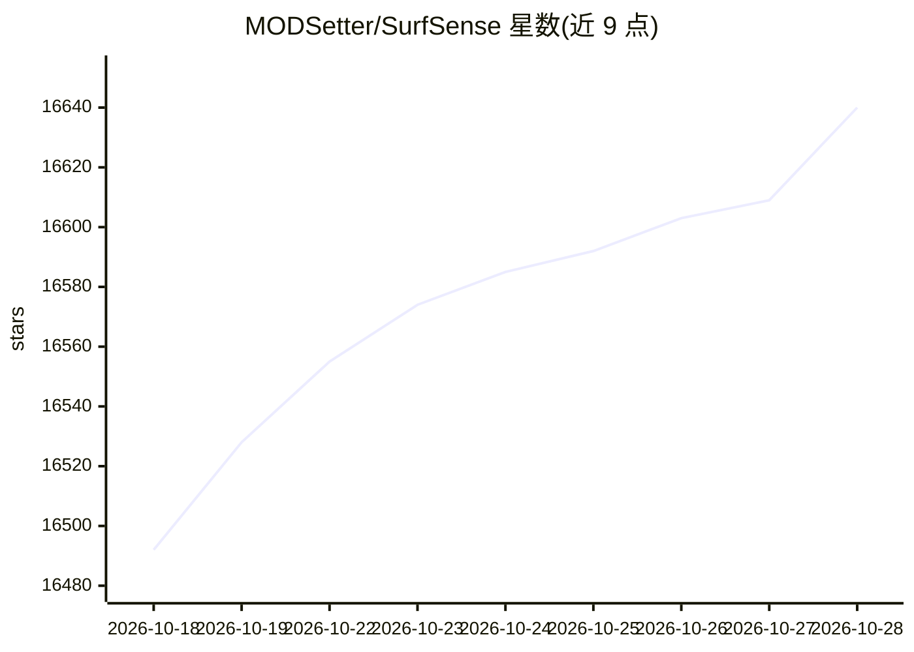

# MODSetter/SurfSense

⭐ 16,640 · Python · Apache-2.0 · 推送 2026-10-27 · [GitHub](https://github.com/MODSetter/SurfSense) · [官网](https://www.surfsense.com) · 个人维护

**本地离线运行的开源 NotebookLM 替代桌面应用**

面向需要在本地处理文档的用户：桌面应用读取 PDF、Office、图像、音视频等格式，提供带引用的回答、文档创建、编辑副本与格式转换，索引保存在本机磁盘，模型可任选本地或 OpenAI 兼容远程 API，无需账号。官方插件（Google 搜索、网页爬取、YouTube 等）需输入邮箱获取 30 天免费许可证；第三方接入走 MCP。托管网页版将停止服务，需在期限内导出工作区迁移到桌面版。

## 筛选速览

| 维度 | 判定 | 备注 |
|---|---|---|
| AI 角色 | `ai-enhanced` | 去掉 AI 部分产品仍成立 |
| 许可风险 | `permissive` | Apache-2.0 |
| 部署形态 | `desktop` | 安装包/桌面程序 |
| 模型依赖 | — | README 未给出锁定关系 |
| 硬件要求 | — | 无带数字的原话,不猜 |
| 安装摩擦 | `low` | 无编译、无系统依赖或容器化 |
| 成熟度 | — | 结构信号不足 |

## 动量与使用信号

- 维护:`active` — 距上次 push 0.9 天,年发版 39,108 位贡献者
- 涨星:近 1 天 **+48**(自 20261016 起算)
- 平台:WINDOWS / MACOS / LINUX / WEB · 协议:OPENAI-API / MCP

## 能力要点

- 支持 PDF/Word/Excel/PPT/图像/录音等多种格式的研究、创建、编辑与转换
- 索引保留在本地磁盘，可选用本地模型，无需账号
- 插件生态：官方网络插件 + MCP 服务器接入
- Apache-2.0 许可，提供 Windows/macOS/Linux 安装包

## 适用场景

- 在内网或断网环境处理涉密/敏感文档
- 对本地文档做带引用的问答与信息提取
- 批量编辑、合并、转换 PDF 与 Office 文件
- 爬取网页、YouTube 等公开内容整理成资料

## 场景标签

`文档问答` `网页抓取` · 领域:效率与自动化

## 证据(README 行号)

> L28: SurfSense is a free, open-source desktop app for documents you can't upload. A privacy-focused, NotebookLM-style AI
> L91: |Open source|No|**Apache-2.0**|
> L97: Apache-2.0. See LICENSE.

## 星数曲线

2026-10-18 16,492 → 2026-10-28 16,640（+148）

---
*卡片 v1 · prompt 1.4 · 生成 2026-10-18 · 置信度 high · 依据 README sha `70e4b0425703` · [字段定义](../../DATASET.md)*
