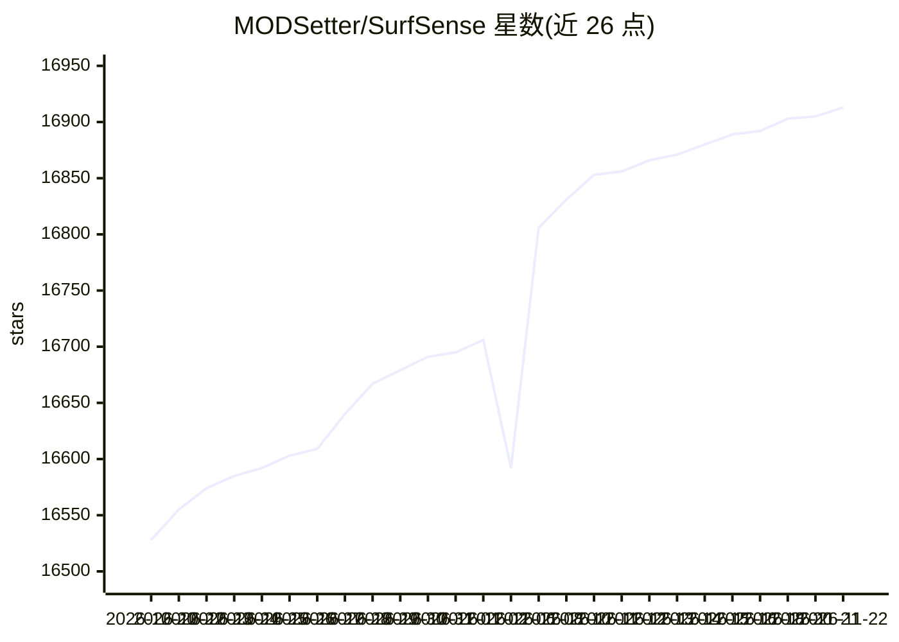

# MODSetter/SurfSense

⭐ 16,913 · Python · Apache-2.0 · 推送 2026-11-14 · [GitHub](https://github.com/MODSetter/SurfSense) · [官网](https://www.surfsense.com) · 个人维护

**本地运行的 NotebookLM 替代桌面应用：研究、转换与编辑文档**

开源桌面应用，宣称可在气隔环境下运行：将 PDF、Word、Excel、PPT、音频等格式加入本地索引，AI agent 对文档生成带引用的回答、创建内容并以副本方式编辑（原文件不被修改），转录与播客语音在本机生成。支持本地或任意 OpenAI 兼容 API 模型，无需账号。提供 Windows/macOS/Linux 安装包与 Docker 自托管脚本；官方插件（搜索、爬虫、社交媒体读取）需免费 14 天许可证，第三方 MCP 插件无需许可证。

## 筛选速览

| 维度 | 判定 | 备注 |
|---|---|---|
| AI 角色 | `ai-native` | 本体是模型或模型工具 |
| 许可风险 | `permissive` | Apache-2.0 |
| 部署形态 | `desktop` | 安装包/桌面程序 |
| 模型依赖 | — | README 未给出锁定关系 |
| 硬件要求 | — | 无带数字的原话,不猜 |
| 安装摩擦 | `low` | 无编译、无系统依赖或容器化 |
| 成熟度 | — | 结构信号不足 |

## 动量与使用信号

- 维护:`active` — 距上次 push 0.9 天,年发版 39,108 位贡献者
- 涨星:近 1 天 **+48**(自 20261016 起算)
- 平台:WINDOWS / MACOS / LINUX / WEB · 协议:OPENAI-API / MCP

## 能力要点

- 多格式文档索引与带引用回答，扫描页与 OCR（拉丁/中文/日文）支持
- 编辑以副本方式生成，原始文件不被改动；音频转录在本机完成
- 模型可选：本地模型或任意 OpenAI 兼容 API，无账号
- 提供 MCP 第三方插件接入与 Docker 自托管脚本

## 适用场景

- 不能上传云端的企业文档，在本机做问答与摘要
- 给 Word 合同做带批注与修订的标红编辑
- 把网页、YouTube、Reddit 等来源整理为文档或网页
- 录制音频转文字、生成播客与思维导图/闪卡/测验

## 场景标签

`RAG` `网页抓取` `文档问答` · 领域:效率与自动化

## 证据(README 行号)

> L34: SurfSense is a free, open-source desktop app for documents you can't upload. A privacy-focused, NotebookLM-style AI
> L103: |Models|Gemini only|Any OpenAI-compatible API, or a local one|

## 星数曲线

2026-10-20 16,528 → 2026-11-22 16,913（+385）

---
*卡片 v1 · prompt 1.4 · 生成 2026-11-22 · 置信度 high · 依据 README sha `9969119e134a` · [字段定义](../../DATASET.md)*
