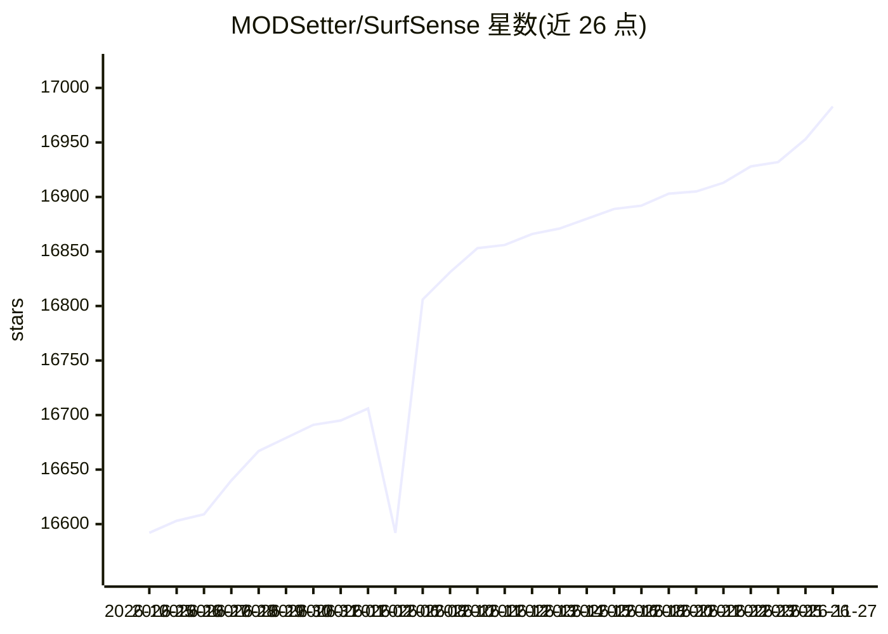

# MODSetter/SurfSense

⭐ 16,983 · Python · Apache-2.0 · 推送 2026-11-26 · [GitHub](https://github.com/MODSetter/SurfSense) · [官网](https://www.surfsense.com) · 个人维护

**本地离线运行的机密文档 AI 桌面应用，开源 NotebookLM 替代**

开源桌面应用，在用户机器上对机密文档进行研究、转换与编辑：索引保存在本地磁盘，无账号，可选本地或远程模型。支持 PDF、Word、Excel、PowerPoint、CSV、图片（OCR 覆盖拉丁文/中文/日文）、音频本地转录、EPUB 等格式，功能分研究（带引用回答）、创建、编辑（生成副本，原文件不变）、转换四类，并可生成思维导图、闪卡与测验。编辑与转换始终生成新文件。另支持 MCP 插件与 SearXNG 网络搜索。提供 Windows/macOS/Linux 安装包与 Docker 部署。

## 筛选速览

| 维度 | 判定 | 备注 |
|---|---|---|
| AI 角色 | `ai-native` | 本体是模型或模型工具 |
| 许可风险 | `permissive` | Apache-2.0 |
| 部署形态 | `desktop` | 安装包/桌面程序 |
| 模型依赖 | — | README 未给出锁定关系 |
| 硬件要求 | — | 无带数字的原话,不猜 |
| 安装摩擦 | `low` | 无编译、无系统依赖或容器化 |
| 成熟度 | — | 结构信号不足 |

## 动量与使用信号

- 维护:`active` — 距上次 push 0.9 天,年发版 39,108 位贡献者
- 涨星:近 1 天 **+48**(自 20261016 起算)
- 平台:WINDOWS / MACOS / LINUX / WEB · 协议:OPENAI-API / MCP

## 能力要点

- air-gapped 本地运行，索引保留在本机磁盘，无账号
- 支持 OpenAI 兼容 API 或本地模型，由用户选择
- PDF/Word/Excel 等格式的引用问答、编辑与转换，编辑生成副本不改动原件
- 内置 MCP 插件接入（如 DeepWiki、Notion）与 SearXNG 网络搜索

## 适用场景

- 在离线/内网环境处理机密文档并提问
- 对合同做带修订与批注的红线编辑
- 本地转录录音、生成播客、闪卡与测验
- 自托管到服务器，局域网内多设备访问

## 场景标签

`文档问答` `文档解析` `AI 写作` · 领域:内容生成

## 证据(README 行号)

> L10:  Air-gapped, private AI for confidential documents.
> L34: SurfSense is a free, open-source desktop app for confidential documents. A private, NotebookLM-style AI agent that 
> L55: |Format|Research (cited answers)|Create|Edit (as a copy)|Transform|

## 星数曲线

2026-10-25 16,592 → 2026-11-27 16,983（+391）

---
*卡片 v1 · prompt 1.4 · 生成 2026-11-26 · 置信度 high · 依据 README sha `4132a7285d9f` · [字段定义](../../DATASET.md)*
