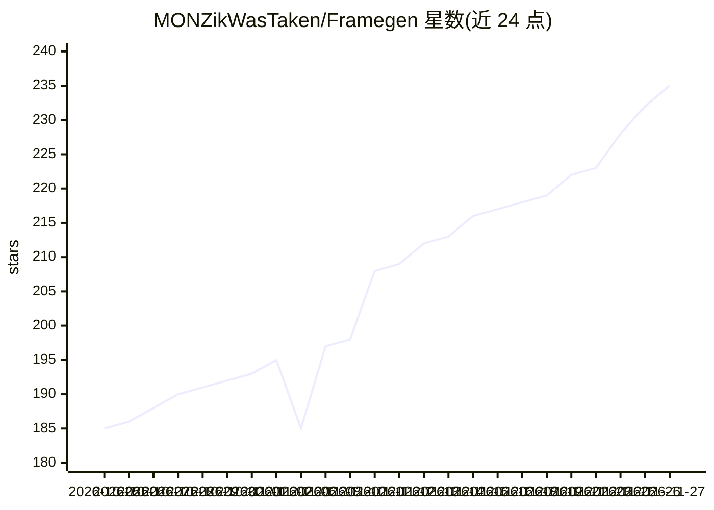

# MONZikWasTaken/Framegen

⭐ 235 · JavaScript · MIT · 推送 2026-11-26 · [GitHub](https://github.com/MONZikWasTaken/Framegen) · [官网](https://chromewebstore.google.com/detail/framegen-frame-interpolat/hpdpcjakhclhljfdkpjolonjlopbdhfk) · 个人维护

**给浏览器视频做实时神经网络插帧的扩展**

浏览器扩展，将网页上任意 <video> 元素（24–30fps）实时插帧到 60–240fps。生成管线运行在用户 GPU 上：2.0 版起采用 FlyHigh 引擎，FlyHighFG 网络（0.78M 参数）的 WGSL 内核编译为 WebAssembly，由引擎 Pacer 决定每个显示 tick 输出内容，单帧生成约 1ms。提供 Auto/动漫模式、精确输出速率网格、对比滑块、2x 神经放大、静态像素保护与多语言界面。不支持 DRM 视频站点；无服务器、无遥测。Chrome/Edge 121+ 或 Firefox 142+ 可用。

## 筛选速览

| 维度 | 判定 | 备注 |
|---|---|---|
| AI 角色 | `ai-native` | 本体是模型或模型工具 |
| 许可风险 | `permissive` | MIT |
| 部署形态 | `None` |  |
| 模型依赖 | — | README 未给出锁定关系 |
| 硬件要求 | — | 无带数字的原话,不猜 |
| 安装摩擦 | `low` | 无编译、无系统依赖或容器化 |
| 成熟度 | — | 结构信号不足 |

## 能力要点

- 2x–6x 实时插帧任意 <video>，FlyHighFG 网络 0.78M 参数运行于 WebGPU/WebAssembly
- Auto 模式按 GPU 与显示器自适应输出倍率并在卡顿前回退
- 动漫模式支持二/三律绘制检测与 cadence 平滑
- 本地运行：无服务器、无遥测、无数据外发

## 适用场景

- 在 YouTube 等网站观看低帧率电影、动画、体育视频时补帧
- 为动漫内容做逐格运动平滑（动漫模式+cadence smoothing）
- 高刷新率显示器用户按屏幕刷新率对齐输出帧率

## 场景标签

`图像视频处理` · 领域:感知与多模态

## 证据(README 行号)

> L5: **Smooth video in your browser.** An extension that turns 24 to 30 fps video into 60 to 240 fps in real time, with a
> L32: Since 2.0 the generation runs on the FlyHigh engine: the FlyHighFG
> L47: Requirements: **Chrome or Edge 121+** (Windows, macOS with Apple Silicon, Linux) or **Firefox 142+ on Windows**, an

## 星数曲线

2026-10-25 185 → 2026-11-27 235（+50）

---
*卡片 v1 · prompt 1.4 · 生成 2026-11-25 · 置信度 high · 依据 README sha `405c0acb959c` · [字段定义](../../DATASET.md)*
