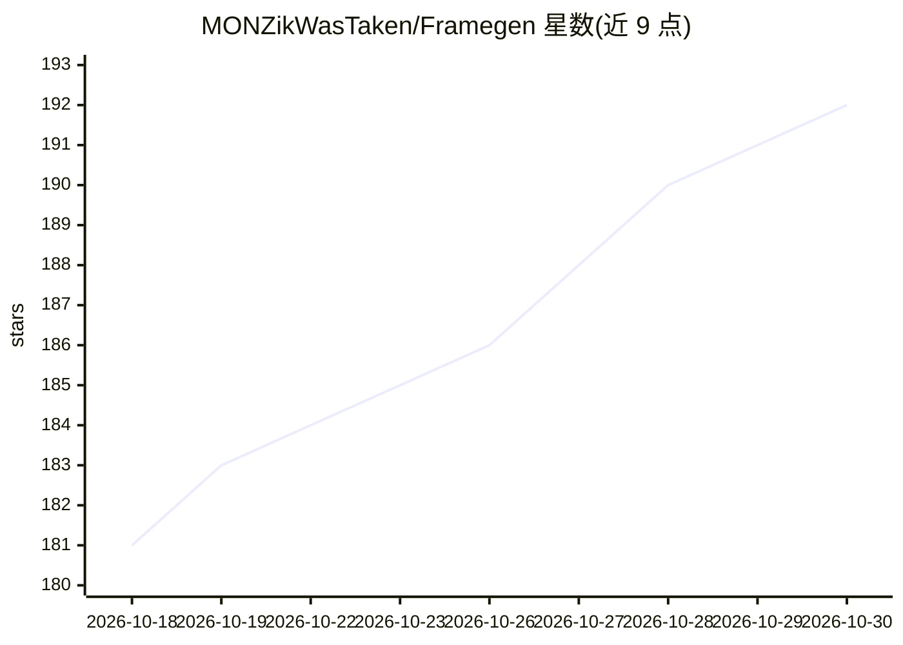

# MONZikWasTaken/Framegen

⭐ 192 · JavaScript · MIT · 推送 2026-10-23 · [GitHub](https://github.com/MONZikWasTaken/Framegen) · [官网](https://chromewebstore.google.com/detail/framegen-frame-interpolat/hpdpcjakhclhljfdkpjolonjlopbdhfk) · 个人维护

**浏览器内实时神经视频插帧的 Chrome 扩展**

Chrome 扩展，将 24-30 fps 的 <video> 实时插帧至 60-240 fps（2×-6×），支持 YouTube 等多数视频站点，DRM 保护视频（Netflix 等）不可用。核心为 2.9 MB 的 RIFE 族蒸馏学生模型，运行在手写 WGSL 的原生 WebGPU compute shader 上，无 ML 框架，全流程 GPU 驻留，720p 每帧约 2 ms（RTX 4060 Ti）。提供自动模式按 GPU 余量选倍率、动漫模式、SR 2× 超分、对比滑块与本地配置档案。无服务器无遥测；推理运行时另以 npm 包 framegen（MIT）提供。要求 Chrome 121+ 与 GPU。

## 筛选速览

| 维度 | 判定 | 备注 |
|---|---|---|
| AI 角色 | `ai-native` | 本体是模型或模型工具 |
| 许可风险 | `permissive` | MIT |
| 部署形态 | `desktop` | 安装包/桌面程序 |
| 模型依赖 | — | README 未给出锁定关系 |
| 硬件要求 | — | 无带数字的原话,不猜 |
| 安装摩擦 | `low` | 无编译、无系统依赖或容器化 |
| 成熟度 | — | 结构信号不足 |

## 能力要点

- 手写 WGSL 运行时跑 2.9 MB RIFE 族蒸馏模型，无 ML 框架，全流程 GPU 驻留
- 任意 <video> 2×-6× 实时插帧，自动模式按 GPU 余量选倍率
- 动漫模式识别'一拍二'动画并对真实运动插帧
- 推理运行时以 npm 包 framegen（MIT）供二次开发，权重随包分发

## 适用场景

- 在浏览器把 24-30 fps 影视/动漫视频提升到高刷新率显示器的帧率
- 用对比滑块直观查看插帧前后差异
- 在自己的网页项目中引入 npm 版运行时做实时插帧

## 场景标签

`图像视频处理` · 领域:感知与多模态

## 证据(README 行号)

> L6: video into 60-240 fps in real time - with a neural network running entirely on
> L184: A distilled RIFE-family student (2.9 MB) runs on a hand-written WGSL runtime -

## 星数曲线

2026-10-18 181 → 2026-10-30 192（+11）

---
*卡片 v1 · prompt 1.4 · 生成 2026-10-22 · 置信度 high · 依据 README sha `354bab13cfb3` · [字段定义](../../DATASET.md)*
