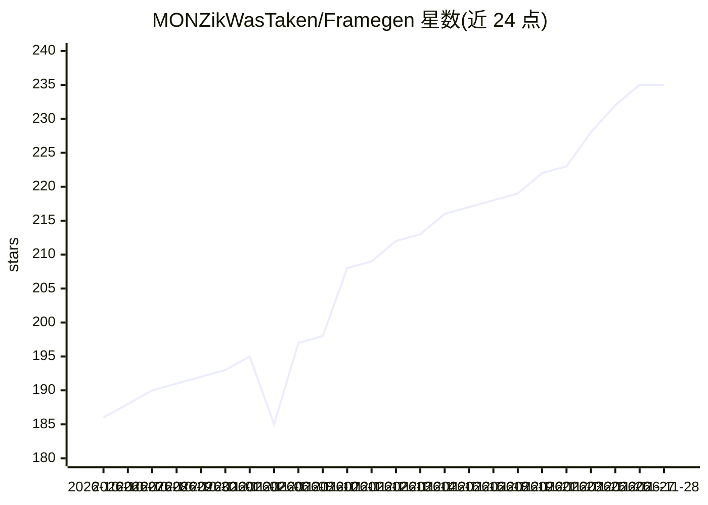

# MONZikWasTaken/Framegen

⭐ 235 · JavaScript · MIT · 推送 2026-11-26 · [GitHub](https://github.com/MONZikWasTaken/Framegen) · [官网](https://chromewebstore.google.com/detail/framegen-frame-interpolat/hpdpcjakhclhljfdkpjolonjlopbdhfk) · 个人维护

**浏览器扩展：用本地神经网络把视频实时插帧到 60-240fps**

Chrome/Edge 与 Firefox 浏览器扩展，对页面中任意 <video> 元素做实时神经插帧，支持 2x-6x 倍帧、Anime 模式（检测二、三拍停帧）、匹配显示器刷新率与自定义 FPS 网格、对比滑块与字幕/logo 静态保护。2.0 起生成由 FlyHigh 引擎承担：FlyHighFG 网络（0.78M 参数）以 WGSL 内核经 WebAssembly 运行在 WebGPU 上。全流程本地 GPU 执行，无服务器与遥测。不支持 DRM 视频（Netflix 等）。

## 筛选速览

| 维度 | 判定 | 备注 |
|---|---|---|
| AI 角色 | `ai-native` | 本体是模型或模型工具 |
| 许可风险 | `permissive` | MIT |
| 部署形态 | `None` |  |
| 模型依赖 | — | README 未给出锁定关系 |
| 硬件要求 | — | 无带数字的原话,不猜 |
| 安装摩擦 | `low` | 无编译、无系统依赖或容器化 |
| 成熟度 | — | 结构信号不足 |

## 能力要点

- 任意 <video> 实时 2x-6x 插帧，每生成帧约 1ms（中端 GPU）
- 基于 WebGPU 的手写 WGSL 运行时，2.9MB 模型，本地推理不上传数据
- Anime 模式：二/三拍停帧检测与可选 cadence 平滑
- 2x 神经超分辨率与七种画面预设

## 适用场景

- 在浏览器里把 24fps 电影或动漫插到显示器刷新率观看
- 为高刷屏（144-240Hz）播放体育或录屏内容
- 在播放器内对比原始与插帧画面

## 场景标签

`图像视频处理` · 领域:感知与多模态

## 证据(README 行号)

> L5: **Smooth video in your browser.** An extension that turns 24 to 30 fps video into 60 to 240 fps in real time, with a
> L32: Since 2.0 the generation runs on the FlyHigh engine: the FlyHighFG

## 星数曲线

2026-10-26 186 → 2026-11-28 235（+49）

---
*卡片 v1 · prompt 1.4 · 生成 2026-11-27 · 置信度 high · 依据 README sha `26a66e092c7d` · [字段定义](../../DATASET.md)*
