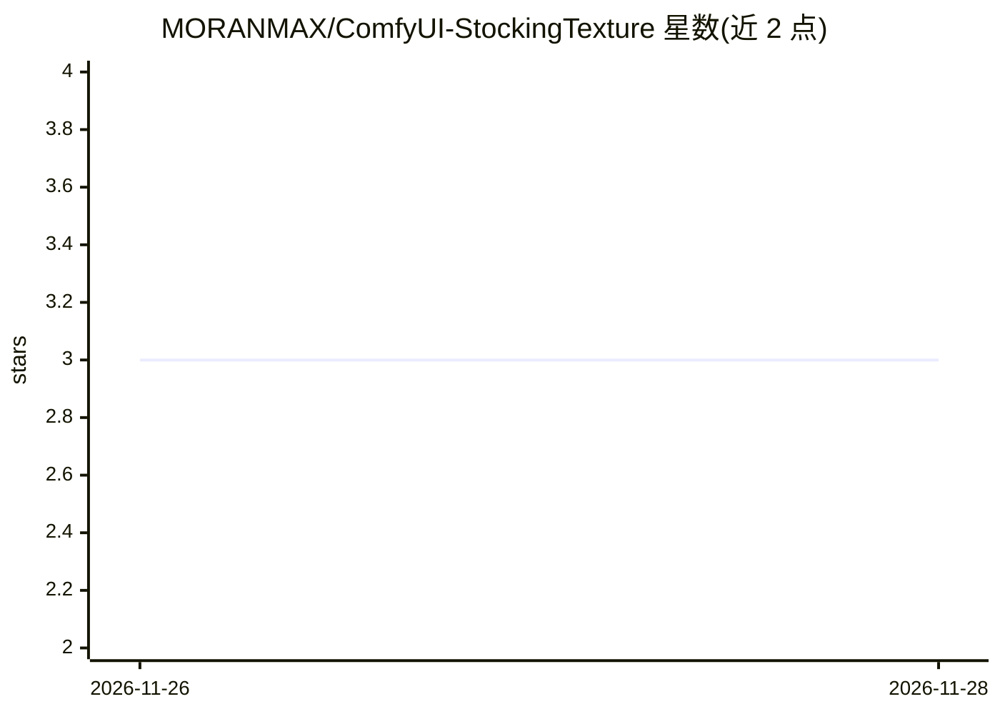

# MORANMAX/ComfyUI-StockingTexture

⭐ 3 · Python · NOASSERTION · 推送 2026-10-22 · [GitHub](https://github.com/MORANMAX/ComfyUI-StockingTexture) · 个人维护 · 中文 README

**给插画丝袜加针织纹理的 ComfyUI 原生节点**

移植自 silvermoong/stocking-texture-tool（MIT）的 ComfyUI 自定义节点，为插画图像添加丝袜针织纹理。接在保存图像节点之后或替代其位置，采样器图像经编辑界面（点选/画笔/走向线/6 种样式/密度/强度等，完整沿用原版约 2700 行 canvas 界面）处理后输出。自动选择功能依赖 SAM（必需，358MB）与 Depth-Anything-V2-Small（可选，95MB）两个第三方模型，需手动下载放入 models/ 目录。支持 git clone/压缩包安装，需重启 ComfyUI。

## 筛选速览

| 维度 | 判定 | 备注 |
|---|---|---|
| AI 角色 | `ai-native` | 本体是模型或模型工具 |
| 许可风险 | `none` | NOASSERTION |
| 部署形态 | `library` | 以包/库形式分发 |
| 模型依赖 | — | README 未给出锁定关系 |
| 硬件要求 | — | 无带数字的原话,不猜 |
| 安装摩擦 | `medium` | 含编译或系统依赖之一 |
| 成熟度 | `idea` | |

## 能力要点

- 照搬原版编辑界面（点选/画笔/切开/走向/镜像/6 种样式/预设/撤销重做）
- 「自动选择丝袜」用 SAM + 深度模型定位丝袜区域并铺走向线
- 节点 widget 与界面滑杆双向同步，预览条处理前/成品并排对比
- 成品保存写盘不排队、不重新采样；提供无浏览器自检脚本 e2e_check.py

## 适用场景

- 在 ComfyUI 工作流里直接给生成的插画加丝袜针织纹理
- 无人值守时开启自动选择，排队即自动铺走向线出纹理
- 导出丝袜引导线 PSD 供后期编辑

## 场景标签

`图像视频处理` · 领域:感知与多模态

## 证据(README 行号)

> L21: 一个**原生 ComfyUI 节点**。采样器的图像直接接进来，加过纹理的图像直接接出去——它就是链条末端的那个节点，替代「保存图像」。不用导图、不用手动搬图、结果不落盘也能继续往下走。
> L71: |**自动选择丝袜**|预处理：SAM + 深度模型找出丝袜在哪，填成部位，**只选部位、不画走向线**——选完由你精修|

## 星数曲线

2026-11-26 3 → 2026-11-28 3（+0）

---
*卡片 v1 · prompt 1.4 · 生成 2026-11-26 · 置信度 mid · 依据 README sha `317e4b4974cb` · [字段定义](../../DATASET.md)*
