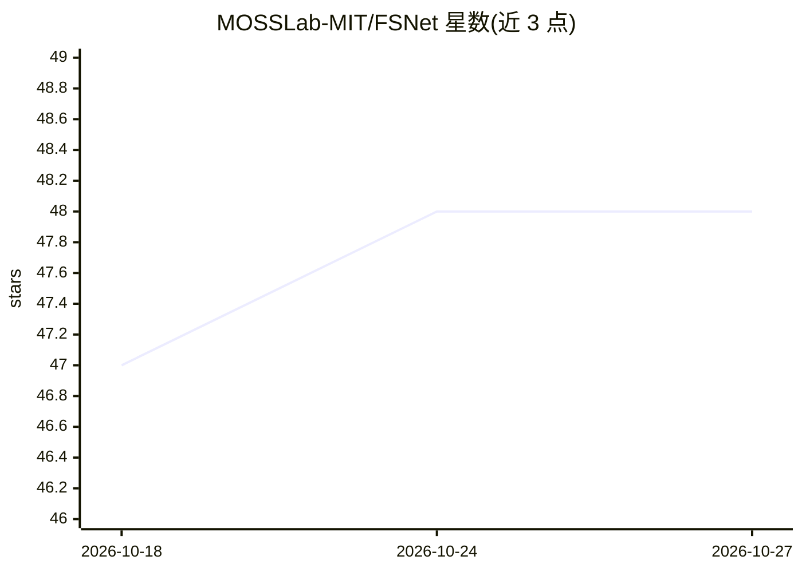

# MOSSLab-MIT/FSNet

⭐ 48 · Python · MIT · 推送 2026-06-09 · [GitHub](https://github.com/MOSSLab-MIT/FSNet) · 个人维护

**将可行性搜索步嵌入求解过程的带约束优化神经网络**

论文配套代码库：FSNet 在神经网络求解约束优化问题时内嵌一个可微的可行性搜索步（求解最小化约束违反的无约束子问题），实现端到端训练并提供可行性与收敛保证。支持凸/非凸/非光滑非凸问题的 QP、QCQP、SOCP 实验，可与 penalty、adaptive_penalty、DC3、projection 等基线方法对比复现。供希望复现论文或研究约束满足学习方法的用户使用；通过 pip 安装 requirements.txt 依赖后以 python main.py 运行。

## 筛选速览

| 维度 | 判定 | 备注 |
|---|---|---|
| AI 角色 | `ai-native` | 本体是模型或模型工具 |
| 许可风险 | `permissive` | MIT |
| 部署形态 | `library` | 以包/库形式分发 |
| 模型依赖 | — | README 未给出锁定关系 |
| 硬件要求 | — | 无带数字的原话,不猜 |
| 安装摩擦 | `low` | 无编译、无系统依赖或容器化 |
| 成熟度 | — | 结构信号不足 |

## 能力要点

- 可微可行性搜索步实现端到端训练并提供可行性/收敛保证
- 覆盖凸、非凸、非光滑非凸三类问题与 QP/QCQP/SOCP
- 内置 penalty、adaptive_penalty、DC3、projection 基线方法对比

## 适用场景

- 复现论文中约束优化求解的实验结果
- 对比 FSNet 与罚函数法、DC3 等基线的求解表现
- 研究满足约束保证的学习型优化方法

## 场景标签

`科研工具` · 领域:学习与行业

## 证据(README 行号)

> L10: Efficiently solving constrained optimization problems is crucial for numerous real-world applications, yet traditio

## 星数曲线

2026-10-18 47 → 2026-10-27 48（+1）

---
*卡片 v1 · prompt 1.4 · 生成 2026-10-25 · 置信度 mid · 依据 README sha `52274cf49cb6` · [字段定义](../../DATASET.md)*
