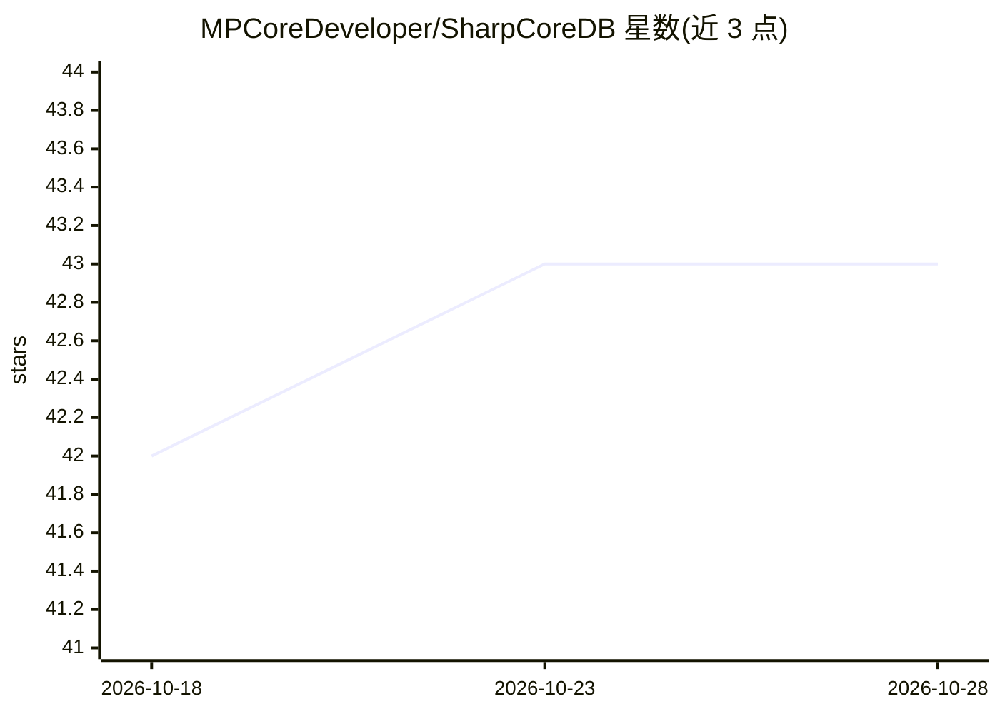

# MPCoreDeveloper/SharpCoreDB

⭐ 43 · C# · MIT · 推送 2026-10-26 · [GitHub](https://github.com/MPCoreDeveloper/SharpCoreDB) · [官网](https://github.com/MPCoreDeveloper/SharpCoreDB) · 组织维护

**面向 .NET 团队的加密嵌入式数据库：单文件加密 + gRPC 服务模式**

.NET 11/C# 15 原生数据库引擎，支持嵌入式与 gRPC（HTTP/2/3）服务器两种部署模式。存储层提供 AES-256-GCM 静态加密、ACID、WAL 语义、固定宽度记录布局与 Brotli/GZip 块压缩；SQL 语义对齐 SQLite；另内置向量检索与 GraphRAG/图算法工具、分析模块、事件溯源/CQRS 可选包。以 27 个 NuGet 包分发，需 .NET 11 SDK 构建，v2.0 线（net10.0）仅维护。README 附带与 SQLite 的基准比率数据及两线版本说明。

## 筛选速览

| 维度 | 判定 | 备注 |
|---|---|---|
| AI 角色 | `ai-enhanced` | 去掉 AI 部分产品仍成立 |
| 许可风险 | `permissive` | MIT |
| 部署形态 | `None` |  |
| 模型依赖 | — | README 未给出锁定关系 |
| 硬件要求 | — | 无带数字的原话,不猜 |
| 安装摩擦 | `medium` | 含编译或系统依赖之一 |
| 成熟度 | — | 结构信号不足 |

## 能力要点

- 嵌入式与 gRPC 服务器双模式，单生态分发
- AES-256-GCM 静态加密 + 信封加密与密钥轮换 API
- 内置向量检索、GraphRAG/图算法与分析模块
- 27 个 NuGet 包发布，覆盖 6 个运行时（win/linux/osx × x64/arm64）

## 适用场景

- .NET 项目内嵌加密单文件数据库存储
- 通过 gRPC 服务器模式提供网络数据库服务
- 在数据库内做向量检索与 GraphRAG 查询

## 场景标签

`向量数据库` `RAG` `知识图谱` · 领域:知识与检索

## 证据(README 行号)

> L22: - Built-in **vector search**, **advanced analytics**, and **GraphRAG/graph algorithms**
> L106: |Vector search + GraphRAG tooling|✅|❌|⚠️ extension-dependent|⚠️ feature varies by product/tier|

## 星数曲线

2026-10-18 42 → 2026-10-28 43（+1）

---
*卡片 v1 · prompt 1.4 · 生成 2026-10-25 · 置信度 high · 依据 README sha `5df45481402b` · [字段定义](../../DATASET.md)*
