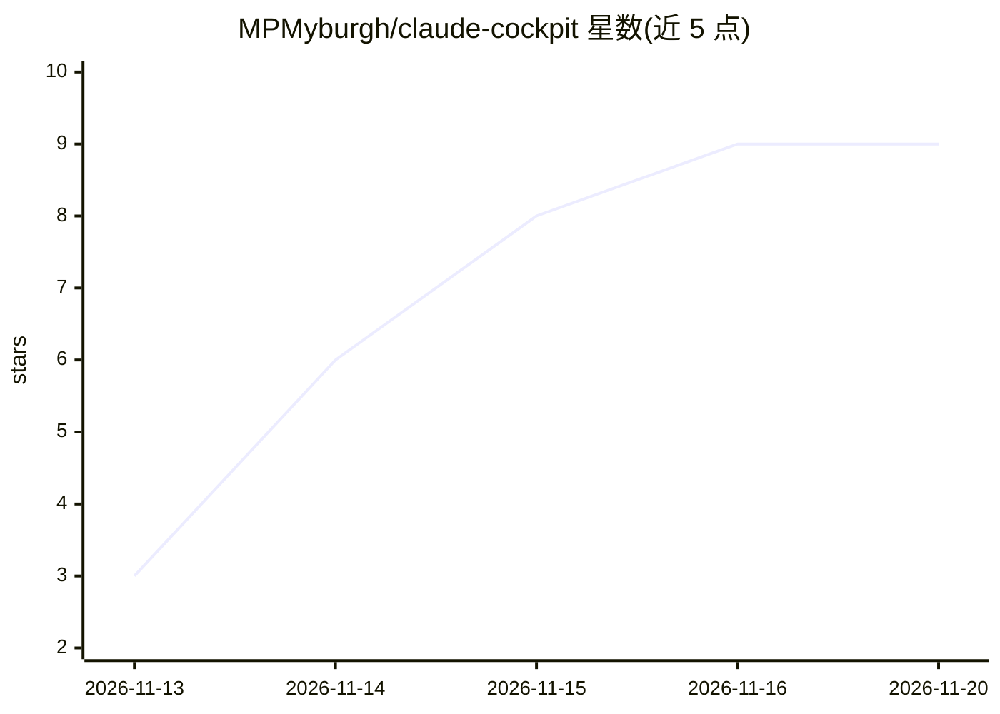

# MPMyburgh/claude-cockpit

⭐ 9 · TypeScript · MIT · 推送 2026-11-11 · [GitHub](https://github.com/MPMyburgh/claude-cockpit) · 个人维护

**给 Claude Code 用户显示各子代理运行状态的侧边栏**

一个 Claude Code mod，在聊天界面旁添加侧边栏，逐秒刷新显示主线程、每个子代理与后台任务的状态：上下文占用、prompt 缓存剩余时间、卡顿（3 分钟无活动标记）、等待审批、错误与预估费用。点击代理可查看最近工具调用与转录、停止代理或向其发送备注；代理完成或失败时发出原生通知。通过 git clone 到 mods 目录并配置插件路径安装，无网络调用，仅读取会话内部数据。

## 筛选速览

| 维度 | 判定 | 备注 |
|---|---|---|
| AI 角色 | `ai-ecosystem` | LLM/agent 周边工具 |
| 许可风险 | `permissive` | MIT |
| 部署形态 | `None` |  |
| 模型依赖 | — | README 未给出锁定关系 |
| 硬件要求 | — | 无带数字的原话,不猜 |
| 安装摩擦 | `low` | 无编译、无系统依赖或容器化 |
| 成熟度 | — | 结构信号不足 |

## 能力要点

- 侧边栏每秒刷新主线程、子代理与后台任务的实时状态
- 上下文用量进度条（80%/90% 变色）、缓存剩余时间与子代理预估费用
- 3 分钟无活动标记 quiet，等待审批时标记 needs approval
- 点击可查看转录、停止代理或发送备注，完成/失败触发系统通知

## 适用场景

- 并行运行多个 Claude Code 子代理时监控各自的进展与卡顿
- 跟踪长会话的上下文占用与 prompt 缓存剩余时间
- 后台批处理运行时在另一窗口工作并通过通知获知完成情况

## 场景标签

`LLM 可观测性` · 领域:评测与运维

## 证据(README 行号)

> L5: A Claude Code mod that adds a sidebar showing what the main thread, every subagent and every background task is doin
> L17: Cockpit keeps those answers in a sidebar next to the chat and redraws it every second while anything is running.
> L57: You need Claude Code with mod support. This was built and tested on Claude Code 2.1.322 on macOS.

## 星数曲线

2026-11-13 3 → 2026-11-20 9（+6）

---
*卡片 v1 · prompt 1.4 · 生成 2026-11-20 · 置信度 high · 依据 README sha `61574250acd6` · [字段定义](../../DATASET.md)*
