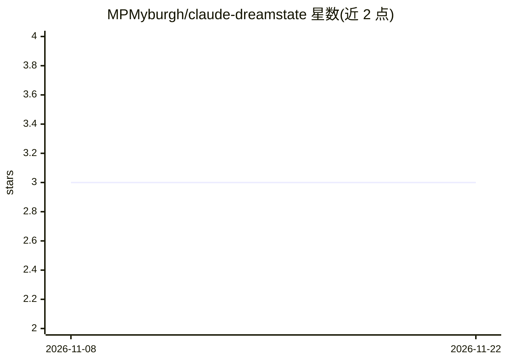

# MPMyburgh/claude-dreamstate

⭐ 3 · TypeScript · MIT · 推送 2026-11-07 · [GitHub](https://github.com/MPMyburgh/claude-dreamstate) · 个人维护

**Claude Code 模组：单次会话换用发散思维规则集替代全局 CLAUDE.md**

一个 Claude Code 模组（mod），在单次对话中用一套发散思维规则集替换用户级全局 CLAUDE.md。规则集以 Lovelace、Feynman、da Vinci、Socrates 为思考锚点，按三阶段运行：深化并确认请求、生成 10 个不同类别的想法并选出 2 个加一张 wildcard、以 Tenth Man 视角复核首选方案。通过 zsh 包装脚本包裹 claude 命令实现重启换轨，借助 prompt.context 钩子替换指令文件，磁盘文件不动，其他终端不受影响。需要支持插件钩子的 Claude Code 与 zsh，在 macOS 的 Claude Code 2.1.319 上构建测试。

## 筛选速览

| 维度 | 判定 | 备注 |
|---|---|---|
| AI 角色 | `ai-ecosystem` | LLM/agent 周边工具 |
| 许可风险 | `permissive` | MIT |
| 部署形态 | `None` |  |
| 模型依赖 | — | README 未给出锁定关系 |
| 硬件要求 | — | 无带数字的原话,不猜 |
| 安装摩擦 | `low` | 无编译、无系统依赖或容器化 |
| 成熟度 | — | 结构信号不足 |

## 能力要点

- /dreamstate 启动新会话并用 dreamstate.md 替换全局规则，/dreamstate off 恢复
- 三阶段流程：Deepen（改写请求并等待确认）、Dream（10 个想法）、Tenth Man review
- claude-restart.zsh 包装脚本在会话间保持 dream 模式，换轨可跨 /compact 存续
- 提供 /restart-claude 原地重启命令，规则集文件可直接编辑定制

## 适用场景

- 在陌生技术领域卡住时，让会话切换到发散思考模式寻找新方向
- 对一段停滞的技术问题做 Tenth Man 式反向复核与多方案比较
- 在正常谨慎规则与探索模式之间按需切换 Claude Code 会话

## 场景标签

`提示工程` · 领域:Agent 开发

## 证据(README 行号)

> L5: A Claude Code mod that swaps your global `CLAUDE.md` for a different rulebook for one conversation: one built for th
> L28: - `claude-restart.zsh` wraps the `claude` command in zsh. The mod's slash commands write a note to a temp file and 
> L36: You need Claude Code with mod support (plugin hooks and `prompt.context`) and zsh. This was built and tested on Cla

## 星数曲线

2026-11-08 3 → 2026-11-22 3（+0）

---
*卡片 v1 · prompt 1.4 · 生成 2026-11-22 · 置信度 high · 依据 README sha `d2683a6e0d88` · [字段定义](../../DATASET.md)*
