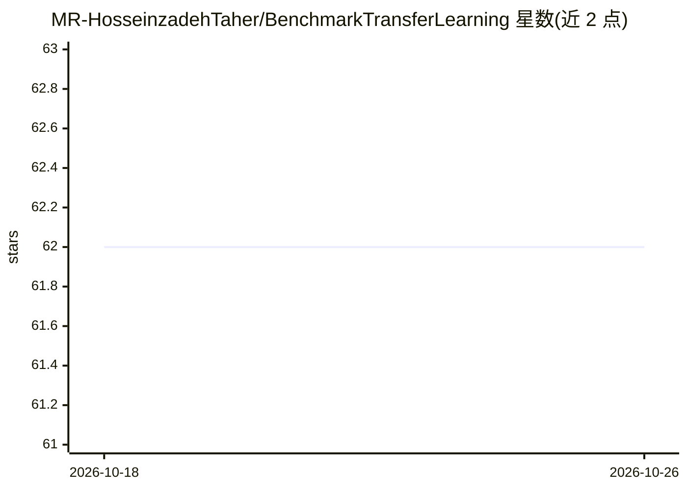

# MR-HosseinzadehTaher/BenchmarkTransferLearning

⭐ 62 · Python · NOASSERTION · 推送 2025-11-17 · [GitHub](https://github.com/MR-HosseinzadehTaher/BenchmarkTransferLearning) · 组织维护

**医学影像迁移学习大规模基准测试的 PyTorch 官方实现与预训练模型库**

论文 Large-scale Benchmarking and Boosting Transfer Learning for Medical Image Analysis（MedIA 2025，ASU 与 Mayo Clinic）的官方 PyTorch 实现：在多个医学影像任务上基准测试多种 ConvNet 与 vision transformer 架构的迁移学习表现，考察微调数据规模、预训练数据粒度、14 种自监督方法的可迁移性以及领域自适应预训练的效果。提供可下载的预训练模型（领域适应版、ImageNet-1K、iNat2021、自监督版）与分类/分割任务的微调、评估训练脚本，支持自行添加数据集。

## 筛选速览

| 维度 | 判定 | 备注 |
|---|---|---|
| AI 角色 | `ai-native` | 本体是模型或模型工具 |
| 许可风险 | `none` | NOASSERTION |
| 部署形态 | `library` | 以包/库形式分发 |
| 模型依赖 | — | README 未给出锁定关系 |
| 硬件要求 | — | 无带数字的原话,不猜 |
| 安装摩擦 | `low` | 无编译、无系统依赖或容器化 |
| 成熟度 | — | 结构信号不足 |

## 能力要点

- 覆盖 ResNet50/Swin/ConvNeXt 等骨干的预训练模型下载（Model Zoo）
- 基准测试多种 ConvNet 与 ViT 架构及 14 种自监督方法的迁移表现
- 提供分类与分割任务的微调/评估命令行脚本
- 提供 ChestX-ray14、CheXpert 等医学数据集的下载链接与数据划分

## 适用场景

- 为医学影像任务选取合适的预训练骨干与预训练策略
- 复现论文中的迁移学习基准实验结果
- 在自有医学数据集上微调领域适应或自监督预训练模型

## 场景标签

`模型评测` · 领域:评测与运维

## 证据(README 行号)

> L1: # Large-scale Benchmarking and Boosting Transfer Learning for Medical Image Analysis
> L2: A comprehensive systematic study of transfer learning of numerous models with distinct architectures pretrained on v
> L217: ## Fine-tuning of pre-trained models on target tasks

## 星数曲线

2026-10-18 62 → 2026-10-26 62（+0）

---
*卡片 v1 · prompt 1.4 · 生成 2026-10-24 · 置信度 mid · 依据 README sha `81313e93dc19` · [字段定义](../../DATASET.md)*
