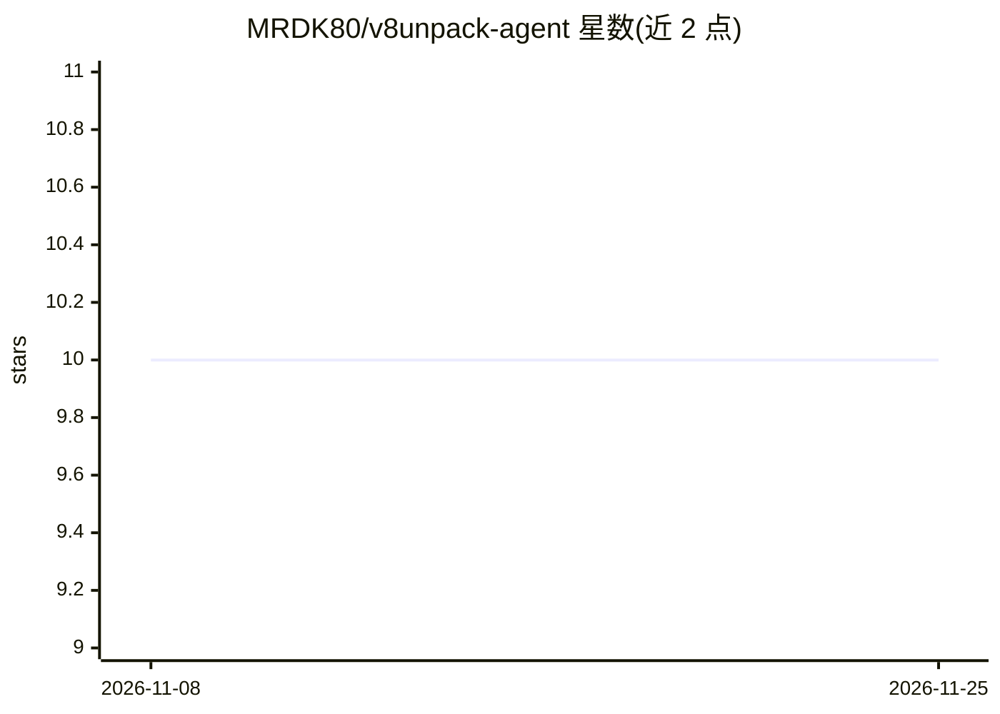

# MRDK80/v8unpack-agent

⭐ 10 · Python · MIT · 推送 2026-11-22 · [GitHub](https://github.com/MRDK80/v8unpack-agent) · [官网](https://infostart.ru/1c/articles/2794715/) · 个人维护

**为 LLM 工具解析 1С 配置的 Python 库与 CLI**

构建在 v8unpack 之上的静态分析工具：将 1С:Предприятие 配置导出中的元数据、托管表单和 BSL 模块转换为可读文本层、表单清单和紧凑的 LLM 上下文。以 Python 库和 CLI 形式提供，支持表单索引、BSL 模块清单、哈希漂移检测、带有输出代码的运行报告，以及带有嵌入器的演示搜索索引。该软件包不提取容器本身，需要上游 v8unpack；未标记为生产就绪，动态表单分析属于选择性启用（opt-in）。

## 筛选速览

| 维度 | 判定 | 备注 |
|---|---|---|
| AI 角色 | `ai-ecosystem` | LLM/agent 周边工具 |
| 许可风险 | `permissive` | MIT |
| 部署形态 | `library` | 以包/库形式分发 |
| 模型依赖 | — | README 未给出锁定关系 |
| 硬件要求 | — | 无带数字的原话,不猜 |
| 安装摩擦 | `low` | 无编译、无系统依赖或容器化 |
| 成熟度 | — | 结构信号不足 |

## 能力要点

- 将 1С 导出转换为表单/模块的机器可读清单及 LLM 提示词片段
- 具有退出报告和明确降级结果状态的 CLI
- 基于模块/结构哈希而非文件时间的漂移检测
- 具有紧凑嵌入器和快照索引的通用搜索 CLI

## 适用场景

- 为分析 1С 配置的 AI 智能体准备上下文
- 对 1С 导出中的托管表单和 BSL 模块进行盘点
- 在多次导出版本之间跟踪漂移

## 场景标签

`文档解析` · 领域:知识与检索

## 证据(README 行号)

> L5: форм и компактный контекст для LLM.
> L10: ## Подключение LLM-агента
> L33: - Пакет не распаковывает контейнер сам: дерево выгрузки готовит upstream

## 星数曲线

2026-11-08 10 → 2026-11-25 10（+0）

---
*卡片 v1 · prompt 1.4 · 生成 2026-11-20 · 置信度 high · 依据 README sha `af36441d36f2` · [字段定义](../../DATASET.md)*
