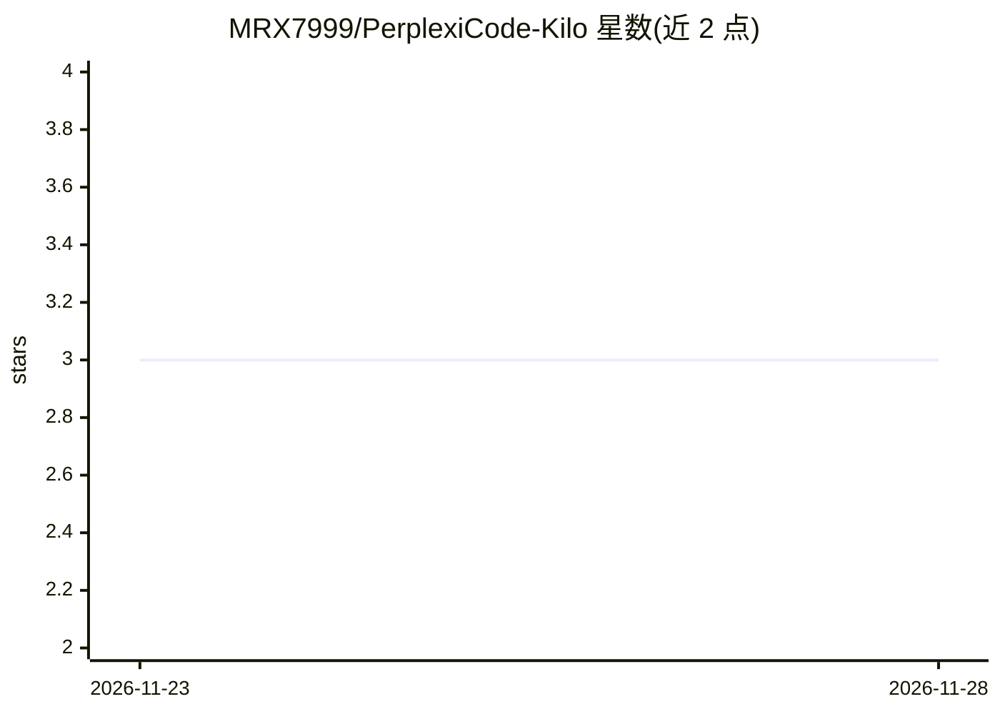

# MRX7999/PerplexiCode-Kilo

⭐ 3 · TypeScript · MIT · 推送 2026-11-27 · [GitHub](https://github.com/MRX7999/PerplexiCode-Kilo) · [官网](https://github.com/MRX7999/PerplexiCode-Kilo#install) · 个人维护

**用 Perplexity 订阅驱动的 IDE/CLI 自主编码代理**

面向 Antigravity IDE、VS Code 及 pcode 终端的自主编码代理，共享同一 agent 核心，通过 Perplexity Pro/Max 网页会话调用模型，无需 API key。提供六种模式（Code/Architect/Ask/Debug/Orchestrator/Review）、行内 diff 审批、编辑检查点、@ 上下文引用、任务历史与自动提交信息；支持 8 个内置子代理与 8 个技能目录、任务预设、MCP 服务器接入及多账户轮换与故障转移。安装方式为 VS Code/Open VSX 市场或 GitHub Releases 安装脚本；使用需 Perplexity 订阅登录。

## 筛选速览

| 维度 | 判定 | 备注 |
|---|---|---|
| AI 角色 | `ai-native` | 本体是模型或模型工具 |
| 许可风险 | `permissive` | MIT |
| 部署形态 | `library` | 以包/库形式分发 |
| 模型依赖 | local-ok | 支持本地模型 |
| 硬件要求 | — | 无带数字的原话,不猜 |
| 安装摩擦 | `low` | 无编译、无系统依赖或容器化 |
| 成熟度 | — | 结构信号不足 |

## 能力要点

- IDE 与 pcode CLI 共享同一 agent 核心，通过 Perplexity 网页会话调用模型，无需 API key
- 六种模式与 diff 审批、命令 Run/Reject、每次编辑的检查点恢复
- 8 个子代理与 8 个技能目录（SKILL.md，兼容 Claude Code 格式）及任务预设
- 多 Perplexity 账户轮换（round-robin/least-used/failover）与配额显示

## 适用场景

- 在 VS Code/Antigravity IDE 中让代理分步规划、编写、运行和调试代码
- 用任务预设一键执行常见工作如审查变更、修 bug、写测试
- 在终端用 pcode CLI 运行同一代理核心完成任务
- 接入 MCP 服务器扩展代理可用工具与资源

## 场景标签

`编码 Agent` · 领域:编码与开发

## 证据(README 行号)

> L19: Platform map: the IDE and pcode CLI share an agent core that connects Perplexity sessions or OpenAI-compatible endp
> L25: **A Kilo Code-style autonomous coding agent for Antigravity IDE and VS Code, powered by your Perplexity Pro / Max s
> L31: |**Agent loop**|The model works step by step with tools, sees each result and continues until the task is done — th

## 星数曲线

2026-11-23 3 → 2026-11-28 3（+0）

---
*卡片 v1 · prompt 1.4 · 生成 2026-11-23 · 置信度 mid · 依据 README sha `5a1d805dff65` · [字段定义](../../DATASET.md)*
