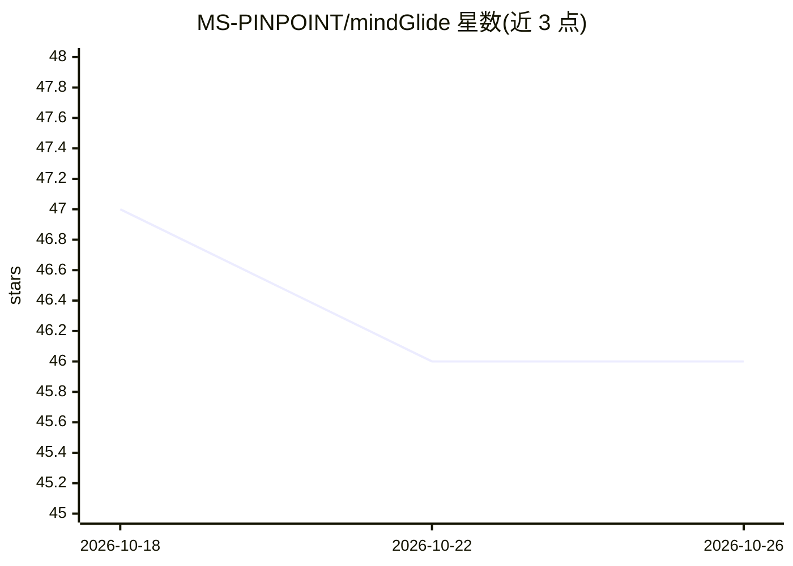

# MS-PINPOINT/mindGlide

⭐ 46 · Python · MIT · 推送 2026-10-06 · [GitHub](https://github.com/MS-PINPOINT/mindGlide) · [官网](https://www.nature.com/articles/s41467-025-58274-8) · 组织维护

**多发性硬化症脑 MRI 分割工具：任意序列、任意质量、免预处理**

基于 PyTorch + MONAI 的脑 MRI 分割命令行与 Python 库，输出 19 个脑区加病灶的标注，针对多发性硬化症研究。读取原始 NIfTI 文件，无需去颅骨、配准或重定向等预处理；支持单扫描或整目录批处理，可汇总生成队列体积 CSV。模型约 123 MB，首次运行自动从 Hugging Face 下载；提供 Docker/Apptainer 镜像与浏览器本地运行入口。声明仅限研究用途，非医疗器械。训练数据逾 23,000 例真实扫描，发表于 Nature Communications。

## 筛选速览

| 维度 | 判定 | 备注 |
|---|---|---|
| AI 角色 | `ai-native` | 本体是模型或模型工具 |
| 许可风险 | `permissive` | MIT |
| 部署形态 | `self-host` | docker 或自建部署 |
| 模型依赖 | — | README 未给出锁定关系 |
| 硬件要求 | — | 无带数字的原话,不猜 |
| 安装摩擦 | `low` | 无编译、无系统依赖或容器化 |
| 成熟度 | — | 结构信号不足 |

## 能力要点

- 零预处理：直接读取原始 NIfTI，内部完成重采样与重定向
- 输出 19 个脑区 + 病灶（Lesion）标注，含各查看器配色表
- GPU 上每扫描数秒、CPU 数分钟；支持 CUDA/MPS/CPU 自适应
- 队列模式可断点续跑并汇总为体积统计 CSV

## 适用场景

- 批处理旧临床 MRI 存档并提取病灶体积统计
- 为多发性硬化症研究队列生成脑区分割标注
- 离线/内网环境用 Docker 镜像运行分割

## 场景标签

`目标检测` · 领域:感知与多模态

## 证据(README 行号)

> L3: ### The Universal Brain MRI Segmentation Tool for Multiple Sclerosis
> L6: Built with **PyTorch + MONAI** | Trained on **>23,000** real-world scans | Published in **Nature Communications**
> L144: **Intended use**: research only. MindGlide is not a medical device and must not

## 星数曲线

2026-10-18 47 → 2026-10-26 46（-1）

---
*卡片 v1 · prompt 1.4 · 生成 2026-10-25 · 置信度 high · 依据 README sha `50b1b2c9316e` · [字段定义](../../DATASET.md)*
