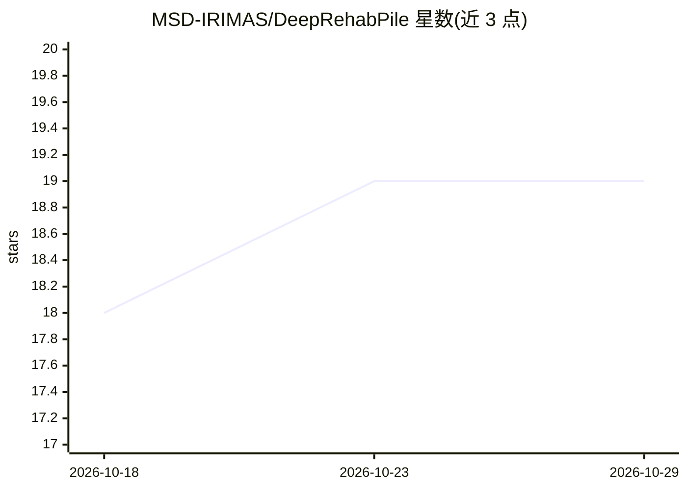

# MSD-IRIMAS/DeepRehabPile

⭐ 19 · Python · GPL-3.0 · 推送 2026-06-07 · [GitHub](https://github.com/MSD-IRIMAS/DeepRehabPile) · [官网](https://msd-irimas.github.io/pages/DeepRehabPile/) · 组织维护

**骨架康复动作评估的深度学习标准化基准与数据集档案**

论文配套代码库：将已有康复动作评估数据仓库聚合为 Rehab-Pile 档案，含 39 个分类与 21 个外回归数据集（共 60 个，脚本下载）；在统一评测协议下对九种深度学习架构做基准对比，每次实验默认跑 5 次初始化并输出集成性能，参数用 Hydra 配置。提供 Docker（含 GPU 加速）与 pip 两种安装方式，需 Python≥3.11 与 jq，注意 Keras v3 需 ≥3.6.0。结果以 CSV 提供。

## 筛选速览

| 维度 | 判定 | 备注 |
|---|---|---|
| AI 角色 | `ai-ecosystem` | LLM/agent 周边工具 |
| 许可风险 | `viral` | GPL-3.0 |
| 部署形态 | `self-host` | docker 或自建部署 |
| 模型依赖 | — | README 未给出锁定关系 |
| 硬件要求 | — | 无带数字的原话,不猜 |
| 安装摩擦 | `low` | 无编译、无系统依赖或容器化 |
| 成熟度 | — | 结构信号不足 |

## 能力要点

- 聚合 60 个数据集（39 分类 + 21 回归）的 Rehab-Pile 档案，脚本一键下载
- 九种深度学习架构的统一基准对比框架
- Docker 镜像支持 GPU 加速
- Hydra 参数配置，支持单实验与全量基准复现

## 适用场景

- 我要复现论文中的康复评估基准实验结果
- 我要在同一协议下对比骨架时序分类/回归模型
- 我要获取整理好的康复动作评估数据集做研究

## 场景标签

`模型评测` · 领域:评测与运维

## 证据(README 行号)

> L20: In this article, we present a benchmark comparison between nine different deep learning architectures on for Skelet
> L25: Automated assessment of human motion plays a vital role in rehabilitation, enabling objective evaluation of patient

## 星数曲线

2026-10-18 18 → 2026-10-29 19（+1）

---
*卡片 v1 · prompt 1.4 · 生成 2026-10-29 · 置信度 high · 依据 README sha `adc664f66575` · [字段定义](../../DATASET.md)*
