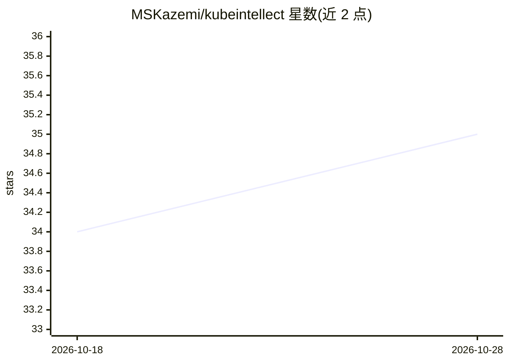

# MSKazemi/kubeintellect

⭐ 35 · Python · MIT · 推送 2026-10-28 · [GitHub](https://github.com/MSKazemi/kubeintellect) · [官网](https://kubeintellect.com) · 个人维护

**面向 SRE/运维的人类审批制 Kubernetes AI 诊断与操作助手**

开源的 LLM 编排多 agent 框架，用自然语言对 Kubernetes 集群做根因分析与诊断：协调器分派子 agent 实时查询 kubectl、Prometheus（PromQL）、Loki（LogQL）并关联证据作答；对 scale/restart/delete 等变更操作设有 RBAC（admin/operator/readonly）分级的人工审批门。面向平台工程师、DevOps、SRE。仓库含 v1–v4 四代实现，v4 为当前版本。要求 LLM API key（OpenAI/Azure OpenAI 开箱即用），集群上下文会外发除非指向自托管端点；默认自主级别封顶 A1，自动修复需显式白名单。

## 筛选速览

| 维度 | 判定 | 备注 |
|---|---|---|
| AI 角色 | `ai-ecosystem` | LLM/agent 周边工具 |
| 许可风险 | `permissive` | MIT |
| 部署形态 | `self-host` | docker 或自建部署 |
| 模型依赖 | locked-api |  |
| 硬件要求 | — | 无带数字的原话,不猜 |
| 安装摩擦 | `low` | 无编译、无系统依赖或容器化 |
| 成熟度 | `idea` | |

## 能力要点

- 自然语言问答关联 kubectl + Prometheus + Loki 三源证据
- 变更操作需人工审批，RBAC 三级权限控制
- v4 平台版含检测引擎、记忆层级、飞行记录器与自主阶梯（A1 默认）
- 提供 CLI（kq）、Docker 镜像、浏览器 Demo 与 Snap 包

## 适用场景

- 排查 pod 崩溃循环时用一句话拿到根因分析
- 对集群执行受审批门保护的扩缩容/重启/删除操作
- 用 init 向导部署故障场景做学习和演练

## 场景标签

`Agent 框架` `多智能体` · 领域:Agent 开发

## 证据(README 行号)

> L32: KubeIntellect is an open-source, LLM-orchestrated multi-agent framework — **the human-governed AI SRE for Kubernete
> L45: - **It is for** platform engineers, DevOps engineers, SREs, and Kubernetes operators who want to troubleshoot and m

## 星数曲线

2026-10-18 34 → 2026-10-28 35（+1）

---
*卡片 v1 · prompt 1.4 · 生成 2026-10-25 · 置信度 high · 依据 README sha `7d82ea7eaddd` · [字段定义](../../DATASET.md)*
