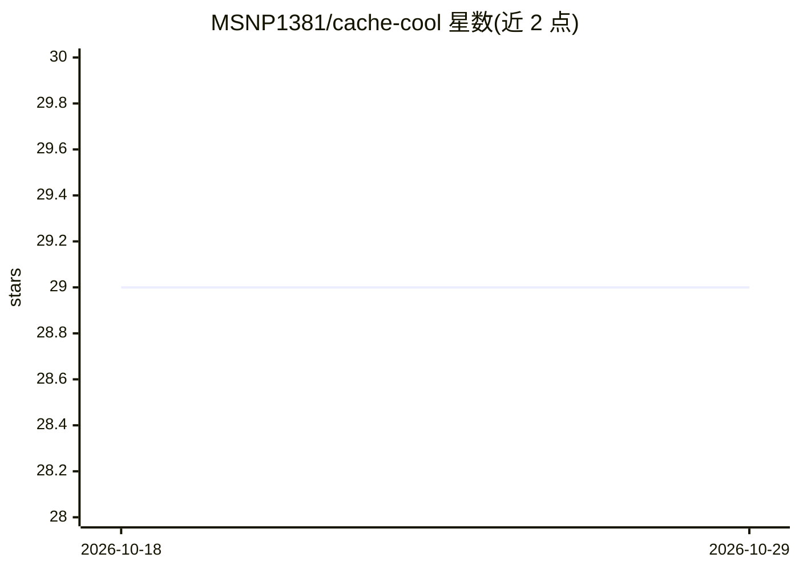

# MSNP1381/cache-cool

⭐ 29 · Python · 推送 2026-05-08 · [GitHub](https://github.com/MSNP1381/cache-cool) · [官网](https://msnp1381.github.io) · 个人维护

**LLM API 缓存代理：缓存重复调用以降低延迟与费用**

基于 FastAPI 的 LLM API 缓存代理：以代理层形式拦截 chat completions 请求，命中缓存则直接返回，未命中则转发至配置的 LLM 服务（如 OpenAI、Claude、Groq）。支持 MongoDB、Redis、JSON 文件三种缓存后端，JSON 与 Mongo 缓存实现了 LRU 淘汰（Redis 依赖其内置策略），可通过 /configure 端点动态更新配置，config.yaml 按 schema 区分不同 LLM 服务。提供 Docker 与本地 Uvicorn 两种运行方式，运行需自备 MongoDB 实例，Redis 为可选。

## 筛选速览

| 维度 | 判定 | 备注 |
|---|---|---|
| AI 角色 | `ai-ecosystem` | LLM/agent 周边工具 |
| 许可风险 | `none` | — |
| 部署形态 | `self-host` | docker 或自建部署 |
| 模型依赖 | — | README 未给出锁定关系 |
| 硬件要求 | — | 无带数字的原话,不猜 |
| 安装摩擦 | `low` | 无编译、无系统依赖或容器化 |
| 成熟度 | — | 结构信号不足 |

## 能力要点

- 缓存 LLM API 响应以减少重复请求
- 支持 MongoDB、Redis、JSON 三种缓存后端
- JSON/Mongo 缓存实现 LRU 淘汰，Redis 依赖其内置策略
- /configure 端点支持动态配置 LLM 服务与缓存机制

## 适用场景

- 高频调用 LLM API 的应用通过缓存降低延迟与成本
- 开发/测试场景复用相同请求的模型响应
- 多 LLM 服务切换时统一经由代理层管理缓存

## 场景标签

`模型网关` · 领域:Agent 开发

## 证据(README 行号)

> L3: **Cache-Cool** is a simple LLM (Large Language Model) caching proxy for saving your LLM calls. It acts as a caching 
> L15: - **🔄 Supports Multiple LLMs**: Configurable to support different LLM services (e.g., OpenAI, Claude, Groq).

## 星数曲线

2026-10-18 29 → 2026-10-29 29（+0）

---
*卡片 v1 · prompt 1.4 · 生成 2026-10-26 · 置信度 mid · 依据 README sha `237e3a309152` · [字段定义](../../DATASET.md)*
