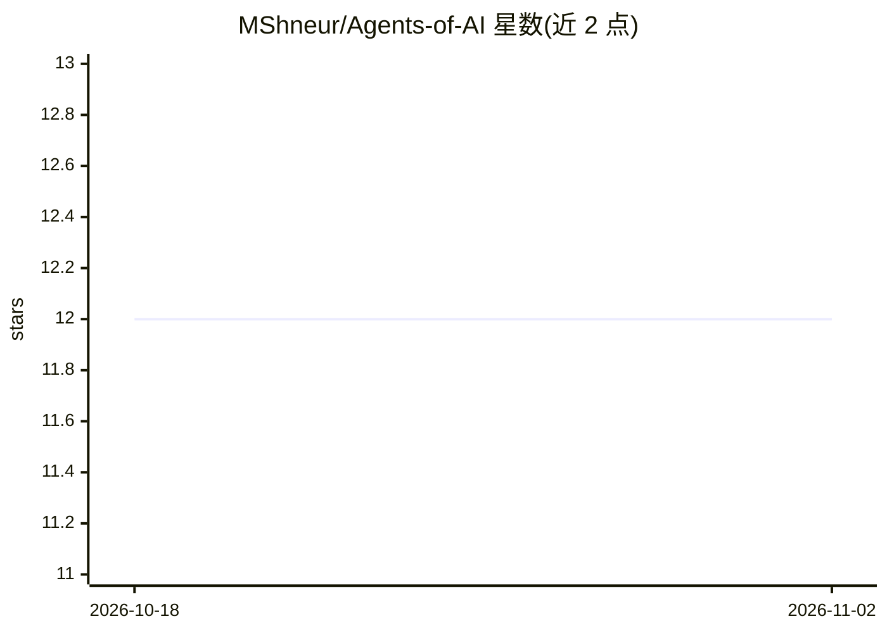

# MShneur/Agents-of-AI

⭐ 12 · JavaScript · MIT · 推送 2026-10-28 · [GitHub](https://github.com/MShneur/Agents-of-AI) · 个人维护

**面向任意 AI 的角色/代理/工作流文件库，可直接复制粘贴使用**

社区维护的可复用 AI 组件库，提供 95 个可组合条目，按七层组织：人设（voice+推理签名）、代理（操作方法+协议）、工作流（可重复步骤序列）、技巧、模式、团队与失败模式。本体是 Markdown 文件而非框架或运行时：使用者将文件内容复制粘贴到任意 AI 的系统提示词或自定义指令中即可，也可被 CTRL-AI、R-Duck 等治理框架按需加载。另含工具架目录（软件推荐、API 清单、免费额度台账）。

## 筛选速览

| 维度 | 判定 | 备注 |
|---|---|---|
| AI 角色 | `ai-knowledge` | 知识聚合/清单类 |
| 许可风险 | `permissive` | MIT |
| 部署形态 | `None` |  |
| 模型依赖 | — | README 未给出锁定关系 |
| 硬件要求 | — | 无带数字的原话,不猜 |
| 安装摩擦 | `low` | 无编译、无系统依赖或容器化 |
| 成熟度 | — | 结构信号不足 |

## 能力要点

- 七层结构：personas/agents/workflows/techniques/modes/teams/failures 共 95 个条目
- 厂商无关：文件可粘贴进 ChatGPT、Claude、Gemini、DeepSeek 等任何读取文本的 AI
- 每层有判别测试（如去掉协议只剩声音即为人设）
- 附带工具架：软件推荐、API/MCP 目录、免费与学生额度台账

## 适用场景

- 为我的 AI 助手挑选一个专业人设或操作代理
- 复用现成的研发、调试、安全审计工作流而不自建框架
- 在治理框架（CTRL-AI/R-Duck）中按需加载这些组件

## 场景标签

`提示工程` `精选清单` · 领域:Agent 开发

## 证据(README 行号)

> L3: **The open library of personas, agents, workflows, techniques, modes, teams, and failures for any AI.**
> L12: Agents of AI is a community-driven library of reusable AI components. Not a governance framework. Not an agent runt
> L36: This library extracts them, makes them portable, and makes them free. Use them with ChatGPT, Claude, Gemini, DeepSe

## 星数曲线

2026-10-18 12 → 2026-11-02 12（+0）

---
*卡片 v1 · prompt 1.4 · 生成 2026-11-01 · 置信度 high · 依据 README sha `1e01275cf56b` · [字段定义](../../DATASET.md)*
