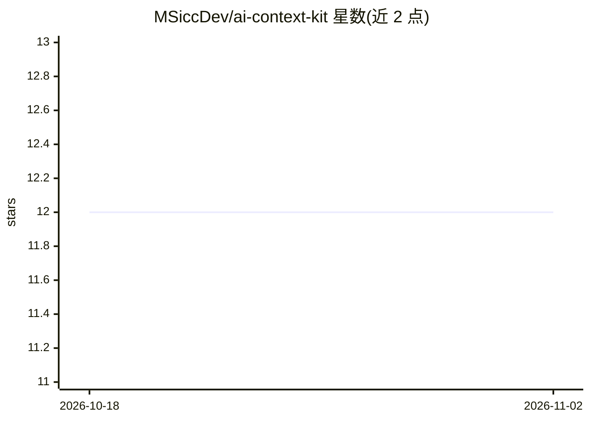

# MSiccDev/ai-context-kit

⭐ 12 · MIT · 推送 2026-10-25 · [GitHub](https://github.com/MSiccDev/ai-context-kit) · 个人维护

**维护跨 LLM 提供商的 AI 协作上下文与技能框架**

提供以 AGENTS.md 为核心的分层上下文体系：个人用户上下文文件加项目级 AGENTS.md，配合会话状态模型（角色/阶段/风格/语气/交互模式）约束 AI 助手行为。包含规范文档（spec v1.5.0）、模板和 11 个 SKILL.md 格式的技能工作流，用于创建与校验上下文工件。面向使用 Claude、Copilot、ChatGPT 等平台的开发者，通过加载或粘贴文件方式调用，提供商中立；校验分数仅反映结构合规，不保证实际效果。

## 筛选速览

| 维度 | 判定 | 备注 |
|---|---|---|
| AI 角色 | `ai-ecosystem` | LLM/agent 周边工具 |
| 许可风险 | `permissive` | MIT |
| 部署形态 | `None` |  |
| 模型依赖 | — | README 未给出锁定关系 |
| 硬件要求 | — | 无带数字的原话,不猜 |
| 安装摩擦 | `low` | 无编译、无系统依赖或容器化 |
| 成熟度 | — | 结构信号不足 |

## 能力要点

- 个人用户上下文 + 项目 AGENTS.md 的分层上下文架构
- 规范 v1.5.0 定义会话状态模型与权威顺序
- 11 个创建/校验/治理类 Agent 技能（SKILL.md 格式）
- 支持 Claude、VS Code Copilot、GitHub Copilot、ChatGPT、本地 API 等调用方式

## 适用场景

- 为多个 AI 编程助手统一维护个人与项目上下文
- 按规范创建和校验 AGENTS.md 与用户上下文文件
- 减少每个会话重复说明背景与偏好的沟通成本

## 场景标签

`提示工程` · 领域:Agent 开发

## 证据(README 行号)

> L4: > **Purpose:** An AGENTS-first, skills-first framework for maintaining consistent, context-aware AI collaboration ac
> L22: - **Provider-agnostic** – Designed to work across different LLM environments; results may vary by platform
> L26: This framework consists of:

## 星数曲线

2026-10-18 12 → 2026-11-02 12（+0）

---
*卡片 v1 · prompt 1.4 · 生成 2026-11-01 · 置信度 high · 依据 README sha `0e80ce492101` · [字段定义](../../DATASET.md)*
