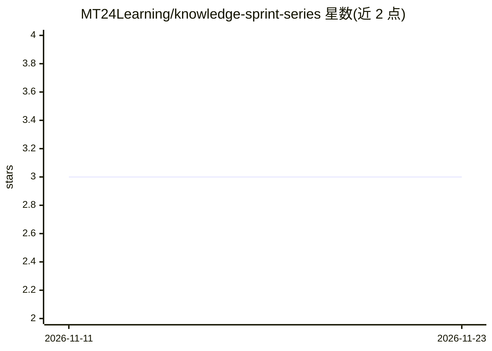

# MT24Learning/knowledge-sprint-series

⭐ 3 · Python · NOASSERTION · 推送 2026-11-20 · [GitHub](https://github.com/MT24Learning/knowledge-sprint-series) · [官网](https://mt24learning.github.io/knowledge-sprint-series/) · 个人维护

**面向学习者的 90 个可视化知识短跑学习路径，逐阶段 DOI 存档**

MT24 Learning 出品的开源可视化学习系列，规划 90 个 sprint、27 个 phase，覆盖从工程基础到科学哲学、统计学、机器学习、Transformer、检索与 AI 安全等内容，目前归档 15 个 phase、48 个 sprint。每个 sprint 是一张信息图，包含核心概念、可运行的命令、迷你项目与可溯源的参考来源；每个 phase 在 Zenodo 存档并附带可引用 DOI。仓库本身是可浏览索引，并提供网站版本与 CHECKSUMS 校验。定位为入门入口而非完整课程。

## 筛选速览

| 维度 | 判定 | 备注 |
|---|---|---|
| AI 角色 | `ai-knowledge` | 知识聚合/清单类 |
| 许可风险 | `none` | NOASSERTION |
| 部署形态 | `None` |  |
| 模型依赖 | — | README 未给出锁定关系 |
| 硬件要求 | — | 无带数字的原话,不猜 |
| 安装摩擦 | `low` | 无编译、无系统依赖或容器化 |
| 成熟度 | — | 结构信号不足 |

## 能力要点

- 90 个 sprint 按 27 个 phase 组织，当前归档 48 个（53%）
- 每个 phase 在 Zenodo 存档并提供可引用 DOI
- 每张信息图含核心概念、可运行命令、迷你项目与参考来源
- 提供 CHECKSUMS.sha256 校验文件完整性

## 适用场景

- 想系统入门机器学习、统计与科学方法论的学习者
- 需要可引用的开源教学材料用于课程或自学
- 想按主题快速定位某一领域（如检索、AI 安全）的图解资料

## 场景标签

`教程课程` · 领域:学习与行业

## 证据(README 行号)

> L10: **A free, open learning path of 90 sprints in 27 phases, from engineering practice to the philosophy of science, st
> L14: This repository is the browsable index of the series: every published sprint, every phase summary and the DOI of ea
> L38:  Phase 14 summary: AI Security & Robustness Phase 14 · AI Security & Robustness Sprints 42–44

## 星数曲线

2026-11-11 3 → 2026-11-23 3（+0）

---
*卡片 v1 · prompt 1.4 · 生成 2026-11-22 · 置信度 high · 依据 README sha `5e292a75a1d3` · [字段定义](../../DATASET.md)*
