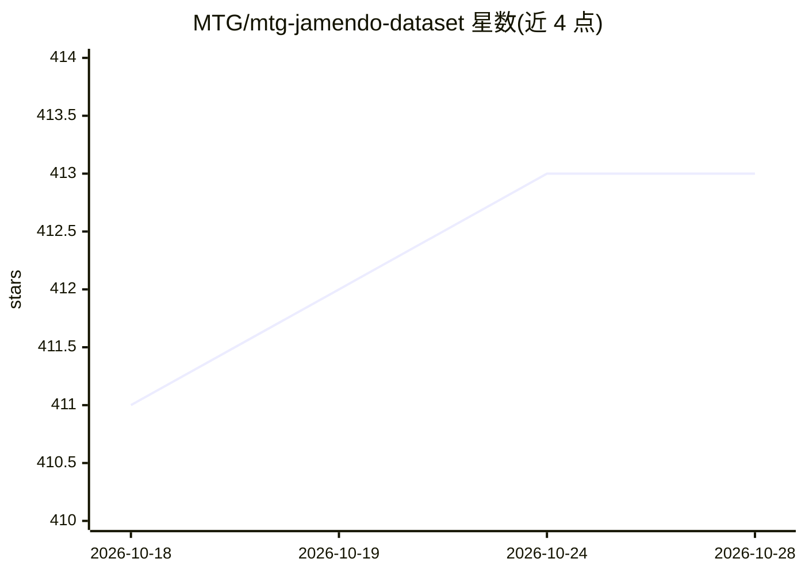

# MTG/mtg-jamendo-dataset

⭐ 414 · Python · Apache-2.0 · 推送 2026-10-16 · [GitHub](https://github.com/MTG/mtg-jamendo-dataset) · 组织维护

**音乐自动标注开放数据集：5.5万首曲目、195个标签及基线**

由 MTG（庞培法布拉大学音乐技术组）发布的音乐自动标注数据集：基于 Jamendo 上 Creative Commons 授权音乐，收录 55,000 余首完整音频曲目与流派、乐器、情绪/主题三类共 195 个标签。仓库提供元数据文件、训练/验证/测试划分、统计脚本、数据下载脚本（音频提供 320kbps MP3、低码率、mel 频谱、Essentia 特征四种形式）以及可复现的基线训练/测试代码。曾被用于 MediaEval 2019-2021 音乐情绪与主题识别任务。

## 筛选速览

| 维度 | 判定 | 备注 |
|---|---|---|
| AI 角色 | `ai-knowledge` | 知识聚合/清单类 |
| 许可风险 | `permissive` | Apache-2.0 |
| 部署形态 | `library` | 以包/库形式分发 |
| 模型依赖 | — | README 未给出锁定关系 |
| 硬件要求 | — | 无带数字的原话,不猜 |
| 安装摩擦 | `low` | 无编译、无系统依赖或容器化 |
| 成熟度 | — | 结构信号不足 |

## 能力要点

- 55,525 首曲目划分为训练/验证/测试集合，含 87 流派、40 乐器、56 情绪/主题标签
- 提供下载与校验脚本，音频含全质量/低码率/mel 频谱/Essentia 特征多种子集
- 附可复现的基线实验（训练/测试脚本）与后处理、统计、子集重建脚本
- 关联 Music Classification Annotations、Song Describer、MuChoMusic 等衍生数据集

## 适用场景

- 训练与评测音乐自动标注（流派/乐器/情绪）模型
- 参加或复现 MediaEval 音乐情绪与主题识别任务
- 作为音乐-语言任务（音乐描述、文本生成音乐）研究的音频来源

## 场景标签

 · 领域:音乐信息检索/音频数据集

## 证据(README 行号)

> L5: We present the MTG-Jamendo Dataset, a new open dataset for music auto-tagging. It is built using music available at 
> L7: This repository contains metadata, scripts, instructions on how to download and use the dataset and reproduce baseli

## 星数曲线

2026-10-18 411 → 2026-10-28 413（+2）

---
*卡片 v1 · prompt 1.4 · 生成 2026-10-21 · 置信度 mid · 依据 README sha `363c7713675a` · [字段定义](../../DATASET.md)*
