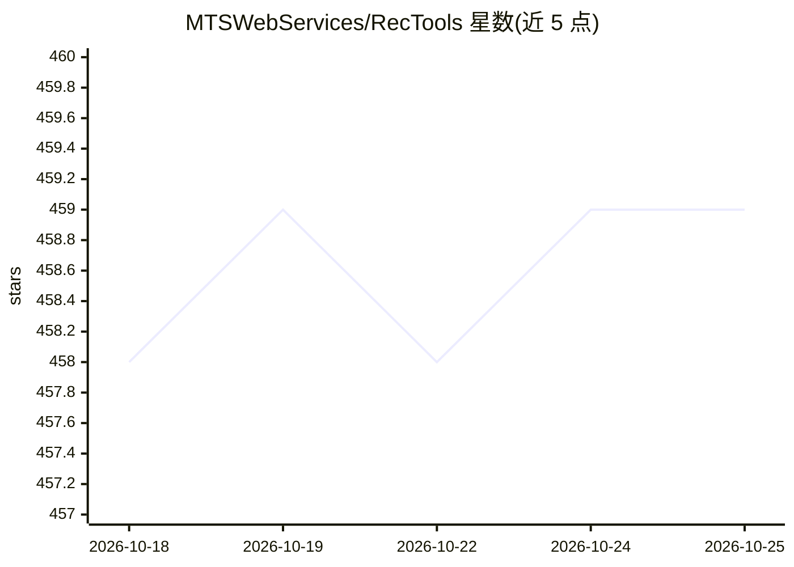

# MTSWebServices/RecTools

⭐ 459 · Python · Apache-2.0 · 推送 2026-10-23 · [GitHub](https://github.com/MTSWebServices/RecTools) · 组织维护

**Python 推荐系统构建库：统一接口提供多种推荐模型**

RecTools 是用于构建推荐系统的 Python 库，面向推荐系统开发与研究人员。提供 HSTU、SASRec、BERT4Rec 等 Transformer 序列模型，以及 ALS/BPR 矩阵分解、ItemKNN、EASE、DSSM、Popular 等模型，全部遵循统一的 fit/recommend 接口，通过 Dataset.construct 自动处理稀疏矩阵与 ID 映射。附带 calc_metrics 交叉验证、去偏指标计算、推荐可视化对比工具。默认安装不含全部依赖，需按需安装 lightfm/torch 等扩展。

## 筛选速览

| 维度 | 判定 | 备注 |
|---|---|---|
| AI 角色 | `ai-native` | 本体是模型或模型工具 |
| 许可风险 | `permissive` | Apache-2.0 |
| 部署形态 | `library` | 以包/库形式分发 |
| 模型依赖 | — | README 未给出锁定关系 |
| 硬件要求 | — | 无带数字的原话,不猜 |
| 安装摩擦 | `medium` | 含编译或系统依赖之一 |
| 成熟度 | — | 结构信号不足 |

## 能力要点

- 十余种推荐模型遵循统一 fit/recommend 接口
- Dataset.construct 自动处理稀疏矩阵、ID 映射与特征接入
- calc_metrics、cross_validate、DebiasConfig 等验证与去偏指标工具
- pip 可选扩展按需安装（lightfm/torch/visuals/nmslib/catboost）

## 适用场景

- 在统一接口下训练与对比多种推荐模型
- 构建带用户/物品特征的推荐管线
- 做去偏指标计算与交叉验证对比模型效果

## 场景标签

`推荐系统` · 领域:学习与行业

## 证据(README 行号)

> L22: RecTools is an easy-to-use Python library which makes the process of building recommender systems easier and
> L84: ## Recommender Models

## 星数曲线

2026-10-18 458 → 2026-10-25 459（+1）

---
*卡片 v1 · prompt 1.4 · 生成 2026-10-21 · 置信度 high · 依据 README sha `22a4edac8394` · [字段定义](../../DATASET.md)*
