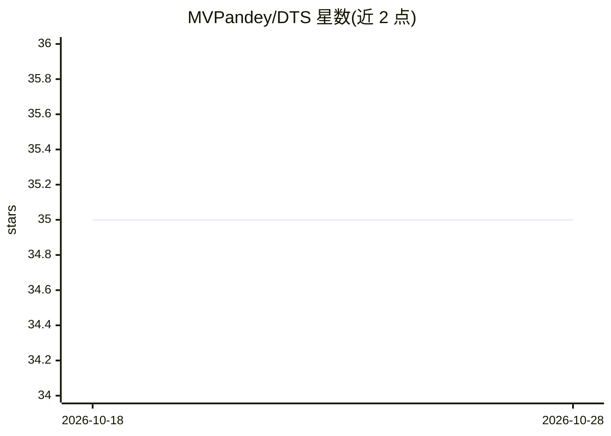

# MVPandey/DTS

⭐ 35 · Python · Apache-2.0 · 推送 2026-01-18 · [GitHub](https://github.com/MVPandey/DTS) · 个人维护

**面向开发者的 LLM 多轮对话策略树搜索优化引擎**

Python 实现的对话树搜索引擎：对同一开场消息并行生成多种对话策略，模拟多类用户人格反应（怀疑/困惑/抵触等），用 3 个独立 LLM 评审按中位数聚合打分，并在每轮剪枝低分分支，从而搜索经过压力测试的对话路径。支持比较式与绝对式两种评分模式，可选 GPT-Researcher 深度研究注入领域上下文。需 OpenRouter API key，默认模型 minimax-m2.1，通过 Docker、启动脚本、uvicorn 或 Python API 运行，附带 FastAPI 服务与 Web 可视化前端。

## 筛选速览

| 维度 | 判定 | 备注 |
|---|---|---|
| AI 角色 | `ai-ecosystem` | LLM/agent 周边工具 |
| 许可风险 | `permissive` | Apache-2.0 |
| 部署形态 | `self-host` | docker 或自建部署 |
| 模型依赖 | locked-api |  |
| 硬件要求 | — | 无带数字的原话,不猜 |
| 安装摩擦 | `low` | 无编译、无系统依赖或容器化 |
| 成熟度 | — | 结构信号不足 |

## 能力要点

- 并行 beam search：expand→score→prune 循环维护多条对话分支
- 多用户人格模拟压测（skeptical/confused/resistant 等 5 类）
- 3 评审中位数聚合打分，支持 comparative/absolute 两种模式
- 可选 GPT-Researcher 深度研究（Tavily 搜索 + Firecrawl 抓取）注入上下文

## 适用场景

- 为客服/谈判/销售类对话 agent 寻找鲁棒的多轮策略
- 在上线前用多样用户人格压测对话策略
- 对比多条候选对话路径并按目标达成度评分剪枝

## 场景标签

`模型评测` · 领域:评测与运维

## 证据(README 行号)

> L10: DTS explores conversation strategies in parallel, simulates diverse user reactions, scores trajectories with multi-
> L173: |**TrajectoryEvaluator**|`backend/core/dts/components/evaluator.py`|Multi-judge scoring with median aggregation|
> L242: > **Model flexibility:** You can use any model available on OpenRouter for any task. The default `minimax/minimax-

## 星数曲线

2026-10-18 35 → 2026-10-28 35（+0）

---
*卡片 v1 · prompt 1.4 · 生成 2026-10-25 · 置信度 high · 依据 README sha `d6f4b98b8fca` · [字段定义](../../DATASET.md)*
