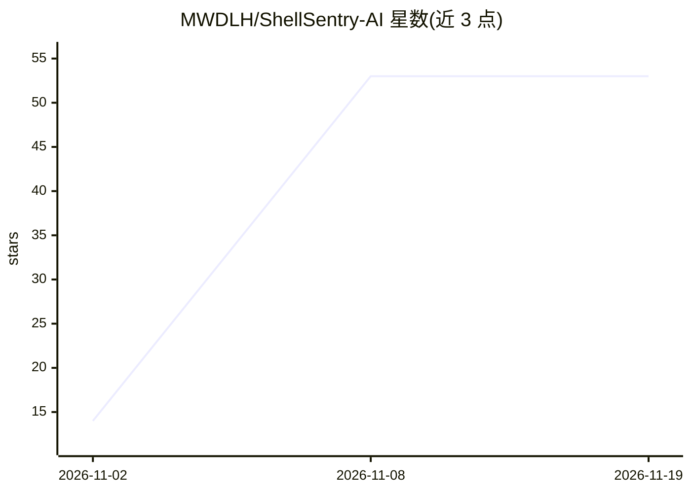

# MWDLH/ShellSentry-AI

⭐ 53 · Python · Apache-2.0 · 推送 2026-10-14 · [GitHub](https://github.com/MWDLH/ShellSentry-AI) · 组织维护 · 中文 README

**恶意代码审计智能体：确定性取证+LLM定性+反证复核**

面向安全审计的 Webshell/恶意代码静态审计智能体，走「取证→定性→复核」流程：工具层做规则扫描（128 条规则、9 类威胁、映射 12 项 CWE）、9 种程序化解码与行为链分析；大模型在证据上推理定性，再由 Agent 反证复核排除误报，输出五段式报告。覆盖 PHP/Java/ASP/Python 等多种语言，全程零执行、不落盘，样本只发往用户自配的 OpenAI 兼容接口。界面无身份认证、默认仅监听本机；纯静态扫描命令不需 API Key。

## 筛选速览

| 维度 | 判定 | 备注 |
|---|---|---|
| AI 角色 | `ai-native` | 本体是模型或模型工具 |
| 许可风险 | `permissive` | Apache-2.0 |
| 部署形态 | `library` | 以包/库形式分发 |
| 模型依赖 | — | README 未给出锁定关系 |
| 硬件要求 | — | 无带数字的原话,不猜 |
| 安装摩擦 | `low` | 无编译、无系统依赖或容器化 |
| 成熟度 | — | 结构信号不足 |

## 能力要点

- 128 条检测规则 + 9 种程序化解码算法，结果确定可复现
- Agent 反证复核：主动证伪、排除误报后才下结论，不确定时不编造
- 零执行零落盘：样本仅作纯文本读取，ZIP 在内存解包，界面仅监听 127.0.0.1
- 识别 Behinder/Godzilla/Cobalt Strike 等家族并输出 IOC/Snort 规则等应急响应内容

## 适用场景

- 应急响应时对疑似 Webshell 做静态取证与定性分析
- 授权渗透或蓝队工作中审计 PHP/JSP/ASPX 等样本
- 本地无 API Key 时用 CLI 跑纯静态规则扫描输出 JSON

## 场景标签

`网络安全` · 领域:学习与行业

## 证据(README 行号)

> L9: **确定性取证 × 大模型定性 × Agent 反证复核的恶意代码审计智能体。**
> L11: 它不是特征库匹配器，而是一个走完「**取证 → 定性 → 复核**」才下结论的 Agent：确定性工具（规则 / 解码 / 行为链）先固定证据，大模型在证据之上推理定性，再经 **Agent 反证复核**（主动证伪、排除误报）。全
> L30: - **工具层**（不需 API Key）：规则扫描、行为链分析、程序化解码 —— 结果确定、可复现；也是 `shellsentry scan` 单独提供的纯静态能力（**输出 JSON**）。

## 星数曲线

2026-11-02 14 → 2026-11-19 53（+39）

---
*卡片 v1 · prompt 1.4 · 生成 2026-11-18 · 置信度 high · 依据 README sha `033fb46ff982` · [字段定义](../../DATASET.md)*
