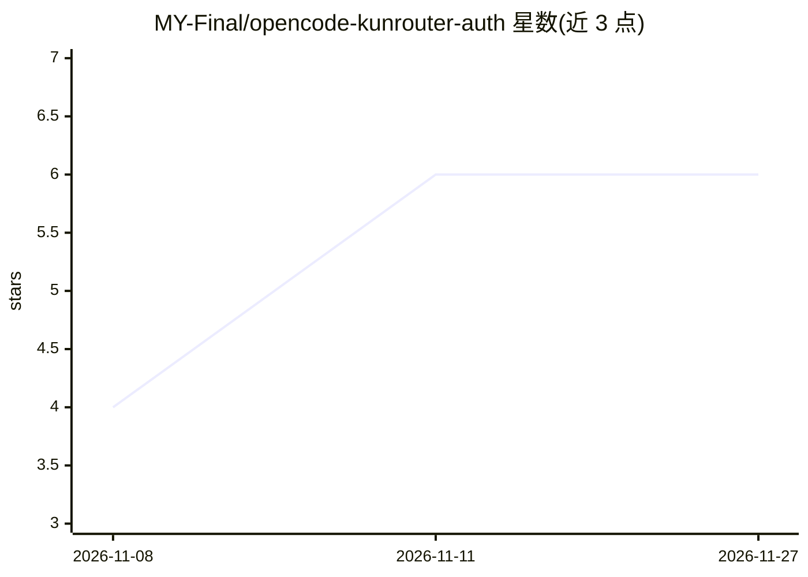

# MY-Final/opencode-kunrouter-auth

⭐ 6 · JavaScript · MIT · 推送 2026-11-22 · [GitHub](https://github.com/MY-Final/opencode-kunrouter-auth) · [官网](https://wcnmb.si) · 个人维护 · 中文 README

**为 Magpie/OpenCode 接入 KunRouter 供应商的授权与额度插件**

KunRouter 站点的 Magpie/OpenCode 供应商插件：提供浏览器 PKCE 一键授权（loopback 回调、令牌不进 URL）、邀请码注册入口、访问令牌与 sk- 密钥的手动填写兜底；展示钱包余额、订阅额度滚动窗口、分组信息，并执行每日自动签到。模型请求可经直连域名绕开 Cloudflare 时限，401 时自动重签同名 Key；模型列表从 /v1/models 拉取并透传能力与推理档位信息。安装依赖宿主 magpie CLI。

## 筛选速览

| 维度 | 判定 | 备注 |
|---|---|---|
| AI 角色 | `ai-ecosystem` | LLM/agent 周边工具 |
| 许可风险 | `permissive` | MIT |
| 部署形态 | `None` |  |
| 模型依赖 | — | README 未给出锁定关系 |
| 硬件要求 | — | 无带数字的原话,不猜 |
| 安装摩擦 | `low` | 无编译、无系统依赖或容器化 |
| 成熟度 | — | 结构信号不足 |

## 能力要点

- 浏览器 PKCE 授权 + loopback 回调，凭据 30 天轮换
- 钱包余额、订阅套餐滚动窗口额度展示与每日自动签到
- 401 时用访问令牌自动重签同名 sk- Key
- 可选直连域名 direct.wcnmb.fun 绕开 Cloudflare 100 秒上限

## 适用场景

- 在 Magpie/OpenCode 中接入 KunRouter 供应商并管理登录态
- 查看该站点的钱包与订阅额度消耗明细
- 自动完成每日签到避免手动操作

## 场景标签

`模型网关` · 领域:Agent 开发

## 证据(README 行号)

> L3: KunRouter 的 **Magpie 插件**（同时兼容 OpenCode）：浏览器一键授权、钱包与订阅额度、每日签到。
> L5: > 维护者：MY-Final · 插件名：KunRouter · 适用：Magpie / OpenCode

## 星数曲线

2026-11-08 4 → 2026-11-27 6（+2）

---
*卡片 v1 · prompt 1.4 · 生成 2026-11-20 · 置信度 high · 依据 README sha `a0eca83a6004` · [字段定义](../../DATASET.md)*
