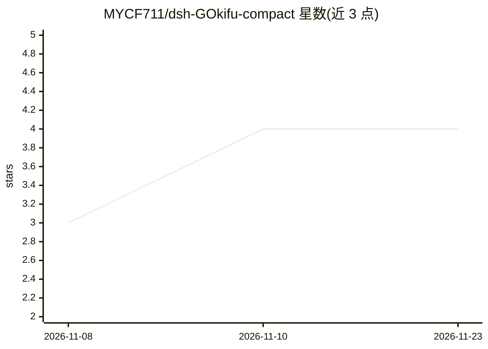

# MYCF711/dsh-GOkifu-compact

⭐ 4 · JavaScript · MIT · 推送 2026-11-21 · [GitHub](https://github.com/MYCF711/dsh-GOkifu-compact) · [官网](https://www.npmjs.com/package/dsh-gokifu-compact) · 个人维护 · 中文 README

**给 DSH 会话换棋谱式上下文压缩后端的插件**

面向 DeepSeek Harness（DSH）的插件，把会话历史压缩方式从单一摘要改为棋谱 DAG：每步生成热清单注入上下文，失败尝试的意图、动作与报错原文由规则逐字保留，支持增量 fold（只压 checkpoint 之后内容）、置换检测、三层树存储与 doctor/handoff-check 等诊断命令。安装方式为 dsh plugin --profile add 到 profile（npm i 不生效），要求 Node ≥ 20 与 DSH ^0.2.0-rc.2，零运行时依赖。README 声明只覆盖四个官方 preset，第三方 preset 模式下不生效。

## 筛选速览

| 维度 | 判定 | 备注 |
|---|---|---|
| AI 角色 | `ai-ecosystem` | LLM/agent 周边工具 |
| 许可风险 | `permissive` | MIT |
| 部署形态 | `library` | 以包/库形式分发 |
| 模型依赖 | — | README 未给出锁定关系 |
| 硬件要求 | — | 无带数字的原话,不猜 |
| 安装摩擦 | `low` | 无编译、无系统依赖或容器化 |
| 成熟度 | — | 结构信号不足 |

## 能力要点

- 增量 fold：一段历史只摘要一次，不重摘
- 失败记忆逐字保留，模型无权丢弃
- 每步注入约 417 tokens 热清单（真实会话 p50=419）
- 压缩摘要三层降级，规则摘要档零模型调用

## 适用场景

- 长会话中保留失败教训避免重复踩坑
- 控制 agent 会话上下文的 token 开销
- 用 doctor/补账工具排查压缩未落地问题

## 场景标签

`Agent 记忆` · 领域:Agent 开发

## 证据(README 行号)

> L8: > **一句话**：给 DSH 会话换一个**上下文压缩后端** —— 把「历史 → 一段摘要」换成
> L96: - **DeepSeek Harness** `^0.2.0-rc.2`（`package.json` 的 `engines.dsh`）
> L124: 2. **按 id 整体覆盖四个官方 agent preset 的 `config`**：把每个 preset 的 compaction group 里

## 星数曲线

2026-11-08 3 → 2026-11-23 4（+1）

---
*卡片 v1 · prompt 1.4 · 生成 2026-11-21 · 置信度 high · 依据 README sha `5adde26ec95f` · [字段定义](../../DATASET.md)*
