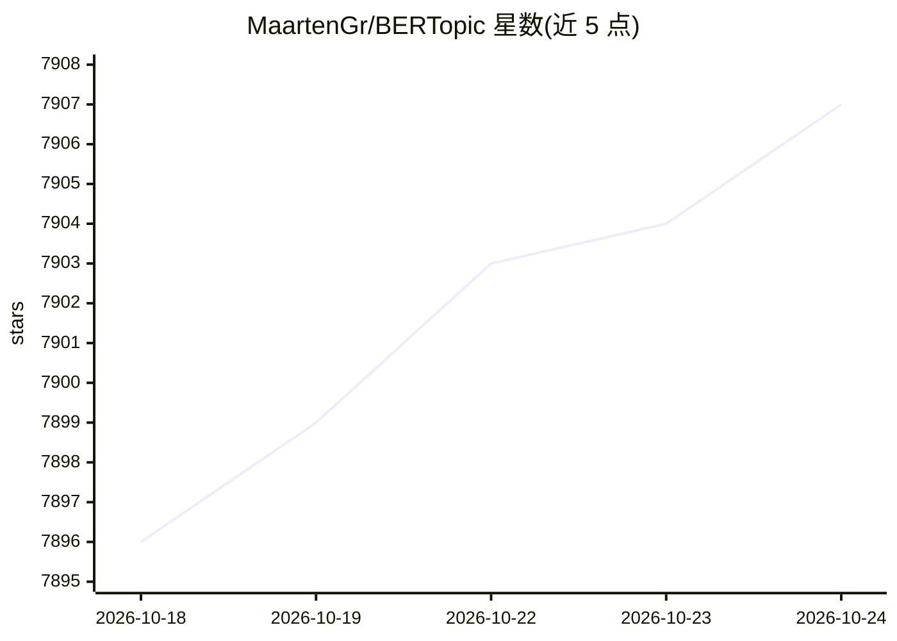

# MaartenGr/BERTopic

⭐ 7,907 · Python · MIT · 推送 2026-10-21 · [GitHub](https://github.com/MaartenGr/BERTopic) · [官网](https://maartengr.github.io/BERTopic/) · 个人维护

**给开发者/NLP 研究者的主题建模库：从文本生成可解释主题**

BERTopic 是基于 transformers 与 c-TF-IDF 的主题建模 Python 库，对文档做嵌入、降维（UMAP）、聚类（HDBSCAN）后生成保留关键词的可解释主题。支持引导/监督/半监督、动态、层次化、多模态、零样本、在线增量等多种主题建模方式，流程各环节（嵌入、降维、聚类、主题表示）均可替换或移除；主题表示可选用 OpenAI 等模型生成标签与摘要。通过 pip/uv 安装，提供 Colab 示例与 arXiv 论文。

## 筛选速览

| 维度 | 判定 | 备注 |
|---|---|---|
| AI 角色 | `ai-native` | 本体是模型或模型工具 |
| 许可风险 | `permissive` | MIT |
| 部署形态 | `library` | 以包/库形式分发 |
| 模型依赖 | — | README 未给出锁定关系 |
| 硬件要求 | — | 无带数字的原话,不猜 |
| 安装摩擦 | `low` | 无编译、无系统依赖或容器化 |
| 成熟度 | — | 结构信号不足 |

## 能力要点

- 嵌入+UMAP+HDBSCAN+c-TF-IDF 的模块化主题建模流程，各环节可替换
- 支持监督/半监督/动态/层次化/多模态/零样本/在线增量等多种变体
- 提供 LDAvis 风格及 11 种主题可视化方法
- 可用 OpenAI 等模型微调主题表示（标签、摘要、关键词）

## 适用场景

- 从大规模文档集合中抽取并解释主题结构
- 追踪语料主题随时间或类别的变化
- 结合图像做多模态主题建模
- 对主题建模结果做可视化探索与汇报

## 场景标签

 · 领域:NLP/机器学习

## 证据(README 行号)

> L11: BERTopic is a topic modeling technique that leverages 🤗 transformers and c-TF-IDF to create dense clusters

## 星数曲线

2026-10-18 7,896 → 2026-10-24 7,907（+11）

---
*卡片 v1 · prompt 1.4 · 生成 2026-10-20 · 置信度 high · 依据 README sha `862b426837cf` · [字段定义](../../DATASET.md)*
