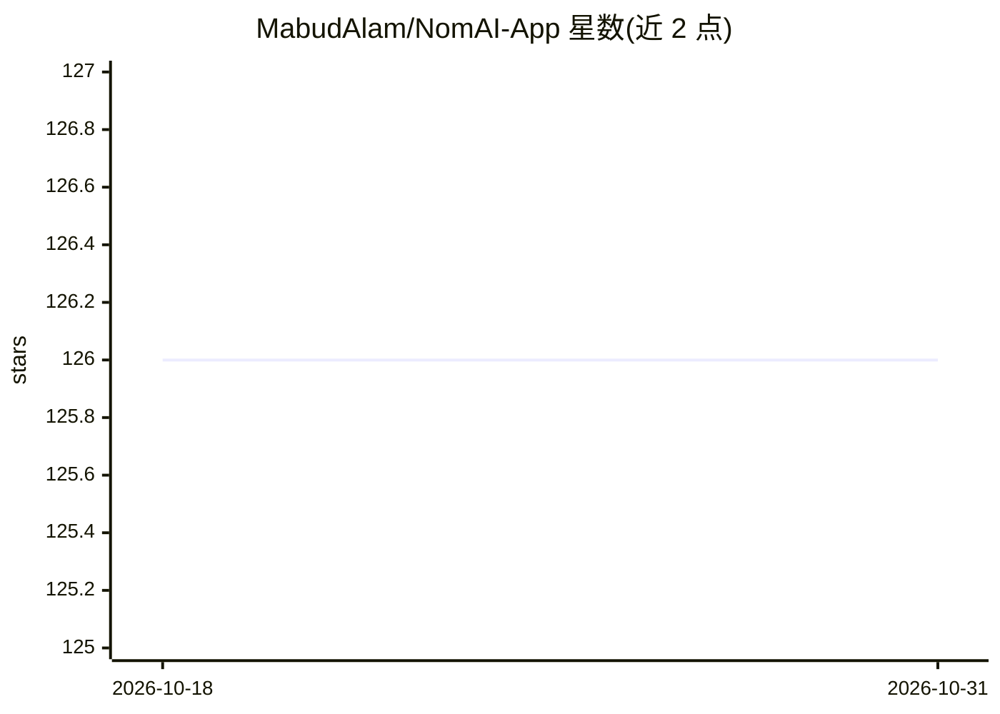

# MabudAlam/NomAI-App

⭐ 126 · Dart · 推送 2026-04-22 · [GitHub](https://github.com/MabudAlam/NomAI-App) · 个人维护

**AI 营养与饮食追踪应用：拍照识别食物并生成周餐单**

Flutter 跨平台（iOS/Android/Web）营养追踪应用，配合独立的 FastAPI 后端（另一仓库）工作。核心功能：通过图片或文字描述分析食物营养，采用三步流水线——食物识别、Exa/DuckDuckGo 网络检索、多模态 LLM 合成；另有对话式营养助手、7 天个性化餐单生成（含碳水循环）、替代餐建议与饮食记录。LLM 后端可在 Google Gemini 与 OpenRouter（Claude）之间切换，数据持久化到 Google Firestore，依赖 Firebase 认证与 Remote Config。需自行部署后端与客户端。

## 筛选速览

| 维度 | 判定 | 备注 |
|---|---|---|
| AI 角色 | `ai-native` | 本体是模型或模型工具 |
| 许可风险 | `none` | — |
| 部署形态 | `None` |  |
| 模型依赖 | locked-api |  |
| 硬件要求 | — | 无带数字的原话,不猜 |
| 安装摩擦 | `low` | 无编译、无系统依赖或容器化 |
| 成熟度 | — | 结构信号不足 |

## 能力要点

- 图片/文字识别食物的三步营养分析流水线（识别→网络检索→LLM 合成）
- 7 天个性化餐单生成，含碳水循环与营养素目标
- 支持 Google Gemini 与 OpenRouter (Claude) 双 LLM 提供商切换
- 聊天记录与餐单存入 Google Firestore

## 适用场景

- 拍照识别食物并获取营养成分分析
- 生成符合自身饮食偏好的每周餐单
- 通过对话向 AI 营养助手咨询并追踪饮食记录

## 场景标签

`多模态` `聊天机器人` · 领域:对话与助手

## 证据(README 行号)

> L3: # NomAI – AI Nutrition & Meal Tracking
> L13: |🧠 **AI Nutrition Analysis**|Analyze food from images or text descriptions with a 3-step pipeline: food extraction 

## 星数曲线

2026-10-18 126 → 2026-10-31 126（+0）

---
*卡片 v1 · prompt 1.4 · 生成 2026-10-23 · 置信度 high · 依据 README sha `0d140124bbb7` · [字段定义](../../DATASET.md)*
