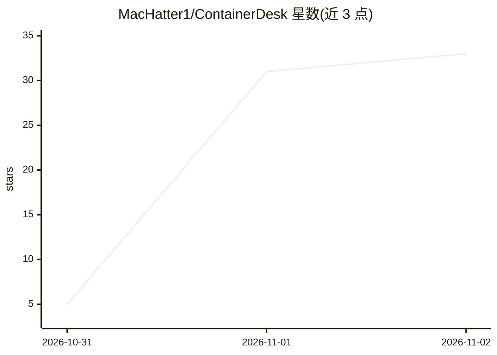

# MacHatter1/ContainerDesk

⭐ 33 · Swift · MIT · 推送 2026-10-31 · [GitHub](https://github.com/MacHatter1/ContainerDesk) · 个人维护

**macOS 原生 GUI，管理 Apple container 运行时并内置本地 MLX 聊天**

基于 SwiftUI 的 macOS 桌面应用，为 Apple `container` CLI 提供图形工作区：浏览/运行/构建/清理 Linux 容器，含实时 CPU/内存仪表、容器内终端、日志合并流、镜像/卷/网络管理、BuildKit 构建、Compose 与本地 Kubernetes 集群管理、环境配置档案与堆栈分组。CLI 仍是运行时权威，应用记录操作预览与 Activity。可选的 Local AI 功能：发现/下载 MLX 模型，启动绑定 127.0.0.1 的 app 自有推理服务器（要求 MLX-LM 精确 0.32.2），并在 Chat Playground 对话。需 Apple silicon + macOS 26+，从源码构建（Swift 6.2）。

## 筛选速览

| 维度 | 判定 | 备注 |
|---|---|---|
| AI 角色 | `ai-enhanced` | 去掉 AI 部分产品仍成立 |
| 许可风险 | `permissive` | MIT |
| 部署形态 | `desktop` | 安装包/桌面程序 |
| 模型依赖 | — | README 未给出锁定关系 |
| 硬件要求 | — | 无带数字的原话,不猜 |
| 安装摩擦 | `low` | 无编译、无系统依赖或容器化 |
| 成熟度 | — | 结构信号不足 |

## 能力要点

- 容器实时 CPU/内存仪表与终端、日志、统计、检查、文件五类详情页
- 本地 MLX 推理服务器（OpenAI 兼容 /v1 端点，仅绑定 127.0.0.1）与 Chat Playground
- BuildKit 镜像构建、Compose 项目与本地 Kubernetes 集群管理
- 可复用环境配置档案与堆栈分组，破坏性操作需确认且不做批量 prune

## 适用场景

- 在原生 macOS 窗口里管理 Apple container 运行时的容器、镜像与卷
- 不装额外工具就在本机跑一个 MLX 模型并对话
- 用图形界面审查并清理未使用的容器资源

## 场景标签

`聊天机器人` `推理引擎` · 领域:对话与助手

## 证据(README 行号)

> L7: Browse, run, build, inspect and clean up Linux containers on your Mac with live resource gauges, a built-in terminal
> L26: - **Local AI built in.** Discover MLX models, serve one on `127.0.0.1`, and chat with it. Conversations stay in mem
> L44:  Local AI : run an app-owned MLX-LM server on loopback and chat with it. Prompts and replies stay in memory and nev

## 星数曲线

2026-10-31 5 → 2026-11-02 33（+28）

---
*卡片 v1 · prompt 1.4 · 生成 2026-10-31 · 置信度 high · 依据 README sha `9618288265eb` · [字段定义](../../DATASET.md)*
